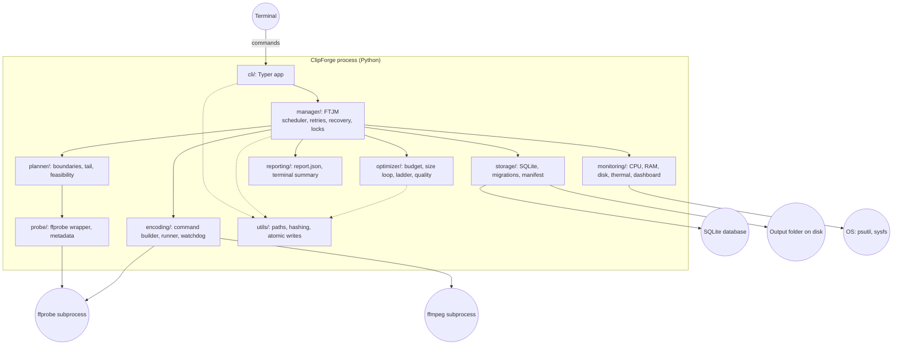
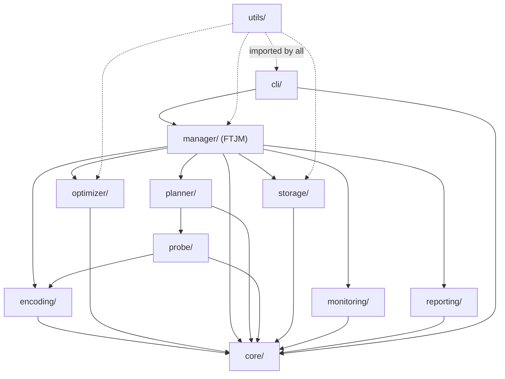
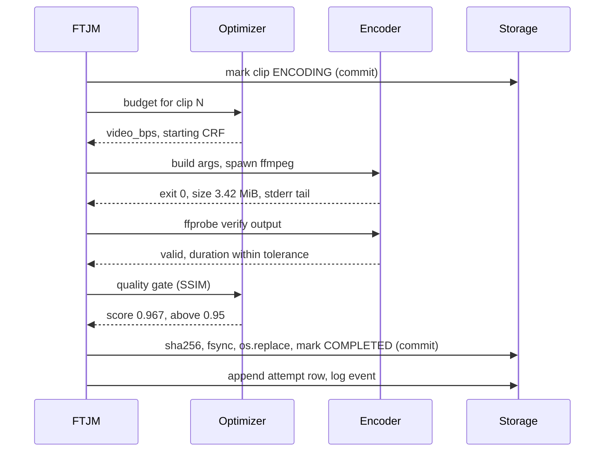
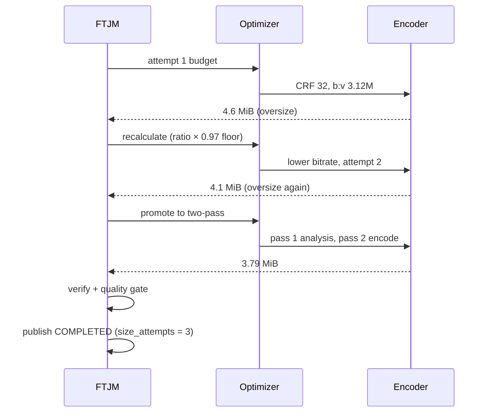
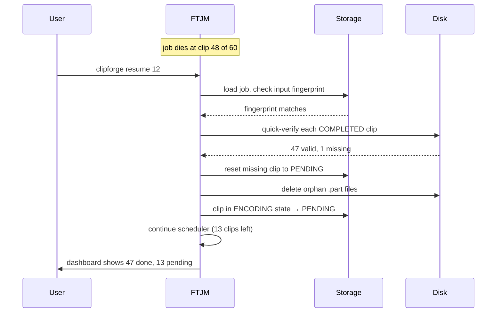

# ClipForge Architecture

| | |
|---|---|
| **Document** | Architecture, version 1.0 |
| **Status** | Approved for build |
| **Owner** | Aakash |
| **Sources** | Master Blueprint v2.0, [PRD.md](PRD.md) |
| **Companion docs** | [README.md](README.md) |
| **Last updated** | 2026-11-12 |
| **Build status** | Phase 1 of 15 done (2026-11-14); everything below describes the v1.0 target |

This document explains how ClipForge is put together: the runtime model, every module and its files, how data moves through a job, how the storage layer is designed, where every file lands on disk, and which technologies carry which responsibility. The PRD says *what* the product must do; this document says *how* it is shaped to do it.

---

## Contents

1. [Architecture principles](#1-architecture-principles)
2. [System at a glance](#2-system-at-a-glance)
3. [Runtime model](#3-runtime-model)
4. [Module reference](#4-module-reference)
5. [Module dependency rules](#5-module-dependency-rules)
6. [End-to-end data flow](#6-end-to-end-data-flow)
7. [Sequence walkthroughs](#7-sequence-walkthroughs)
8. [Storage design](#8-storage-design)
9. [Repository layout](#9-repository-layout)
10. [Runtime locations on disk](#10-runtime-locations-on-disk)
11. [Output folder layout](#11-output-folder-layout)
12. [How FFmpeg is driven](#12-how-ffmpeg-is-driven)
13. [Error taxonomy and exit codes](#13-error-taxonomy-and-exit-codes)
14. [Cross-cutting concerns](#14-cross-cutting-concerns)
15. [Tech stack](#15-tech-stack)
16. [Key design decisions](#16-key-design-decisions)
17. [Known limits of the design](#17-known-limits-of-the-design)

---

## 1. Architecture principles

Four principles shape every decision below, in conflict order:

1. **A clip is the unit of failure.** Nothing in the design lets one bad clip stop a job or corrupt a finished one. This single idea drives the state machines, the database, the atomic publish, and the scheduler loop.
2. **The database is the source of truth.** Files on disk are outputs; `manifest.json` is a portable mirror; SQLite is the authority. Every state change commits to the database before the corresponding file rename happens.
3. **FFmpeg does the media work, Python does the control work.** No frame is ever processed in Python. No frame is ever held in Python memory. The process spawns subprocesses, reads their progress, and makes decisions.
4. **Everything is bounded.** Threads, retries, encode attempts, RAM, log size, stderr in the database, timeouts. Unbounded loops and unbounded memory are design failures, and each one has a named cap.

## 2. System at a glance



One process owns a job from start to finish. FFmpeg and FFprobe are subprocesses, never libraries. The database is a single local file. There are no daemons, no message queues, no network listeners.

## 3. Runtime model

### Process tree

```text
clipforge split video.mp4            python, main process
├── ffprobe -show_format -show_streams   input analysis (once per input)
├── ffmpeg -ss ... clip_0001.part        clip encode (one at a time)
│     └── watchdog: SIGTERM at timeout, SIGKILL 5 s later
├── ffprobe clip_0001.webm               per-clip verification
├── ffmpeg -filter_complex ssim ...      quality gate (tier 1, when enabled)
├── ffmpeg -progress ...                 next pending clip
└── ...
```

### Concurrency model

| Element | Model | Detail |
|---|---|---|
| Scheduler | Single thread, single loop | Picks the next `PENDING` clip, drives it to a terminal state, repeats |
| FFmpeg | Subprocess per encode | Parallelism happens inside FFmpeg (`-threads 3`), not across clips |
| Watchdog | Timeout on the subprocess join | SIGTERM, then SIGKILL after 5 seconds; counts a transient fault |
| Progress | Reader on FFmpeg stdout | `-progress pipe:1` parsed line by line; silence for N seconds means stall |
| Monitoring | One background thread | Samples CPU, RAM, disk, temperature every few seconds into a snapshot the dashboard reads |
| Database | Single connection | WAL mode; the scheduler is the only writer; one transaction per state change |

The GIL is irrelevant here because the heavy work runs in subprocesses. Python's job is decision-making at a rate of one decision per clip, not per frame.

### Job lifetime

A job runs in one process from `clipforge split` to the final report. Interruption (Ctrl+C, crash, power loss) leaves the database holding the truth; the next `resume` or rerun of the same command continues from it. Two processes cannot share a job: the output folder carries an `flock`.

## 4. Module reference

Each module below lists its responsibility, the files it is expected to contain, what it takes in, what it produces, and how it behaves when things go wrong.

### 4.1 `core/`: models, config, errors, constants

The foundation package. Everything else imports from here; it imports from nothing except `utils/`.

| File | Responsibility |
|---|---|
| `models.py` | Typed models: `JobSpec`, `ClipSpec`, `ClipResult`, `AttemptRecord`, `ProbeData`, `CompatibilityReport`. Plain data, no behavior |
| `config.py` | pydantic settings model, YAML load, precedence merge (CLI flags over file over defaults), validation errors that name the offending key |
| `errors.py` | The exception hierarchy: `ClipForgeError` base; `UsageError`, `DependencyError`, `FatalJobError`, `TransientFault`, `PermanentClipError`, `OversizeResult`, `QualityGateFail` |
| `constants.py` | State names, counter caps (4 size, 3 faults, 8 total encodes), the 4 MiB limit, the 5% margin, exit codes, delay schedule |

**Failure behavior:** config errors and usage errors never start a job. A `FatalJobError` raised anywhere propagates to the FTJM, which pauses the job and protects completed clips.

### 4.2 `cli/`: commands and exit codes

| File | Responsibility |
|---|---|
| `main.py` | Typer app assembly, entry point, global options |
| `commands/` | One file per command: `split.py`, `probe.py`, `batch.py`, `resume.py`, `retry.py`, `reprocess.py`, `verify.py`, `doctor.py`, `status.py`, `queue.py`, `report.py`, `config.py`, `benchmark.py`, `clean.py`, `info.py`, `cancel.py` |
| `options.py` | Shared option definitions so `--profile` means the same thing on every command |
| `exit_codes.py` | The documented exit code constants |

The CLI layer parses, validates, hands a fully-typed `JobSpec` to the FTJM, and prints results. It holds no processing logic. FFmpeg always runs from an argument list built in `encoding/`; the CLI never passes shell strings.

### 4.3 `probe/`: input analysis

| File | Responsibility |
|---|---|
| `ffprobe.py` | Runs `ffprobe -show_format -show_streams -show_entries` with JSON output, parses, and normalizes. Handles filenames with spaces, quotes, Unicode, and leading dashes |
| `metadata.py` | Normalized `ProbeData`: duration, start time, coded resolution, rotation matrix, both FPS fields, VFR flag, codec and profile, pixel format and bit depth, color triplet, SAR/DAR, audio layout, time base, frame count |
| `compatibility.py` | Builds the per-input compatibility report: preserved, converted, or applied per property; the bpp feasibility class; the rotation note ("output upright, 1080x1920") |

**Failure behavior:** an unparseable file, a missing video stream, or an audio-only file fails here with a specific message before any job exists. The probe never claims to detect mid-file corruption; it says what it checked.

### 4.4 `planner/`: the plan

| File | Responsibility |
|---|---|
| `boundaries.py` | Integer-microsecond boundary math: `start_i = source_start + i × clip_duration_us`, half-open `[start, end)`. Pure functions, fully unit-tested |
| `tail.py` | Tail policy: `keep`, `merge_into_previous`, `drop`, against `min_tail_seconds` |
| `feasibility.py` | bpp estimate per clip class (`video_bps ÷ (width × height × fps)`), mapped to comfortable, tight, or risky |

**Failure behavior:** the planner never talks to FFmpeg. Bad duration values fail validation in `core/`. A risky plan is not an error; it is a warning the user confirms.

### 4.5 `encoding/`: the FFmpeg boundary

| File | Responsibility |
|---|---|
| `builder.py` | Builds the FFmpeg argument list for one clip: input seek, duration, maps, video codec settings, pixel format, audio settings, output format. The single place where command construction happens |
| `profiles.py` | The three profiles (`fast`, `balanced`, `best`) as concrete settings: deadline, cpu-used, passes, plus shared settings (`-row-mt 1`, tile columns by resolution, `-auto-alt-ref 1`, adaptive `lag-in-frames`) |
| `runner.py` | Spawns the subprocess with the argument list, enforces the watchdog (`max(60 s, duration × timeout_factor)`), performs the SIGTERM then SIGKILL ladder, collects exit code, size, and a bounded stderr tail |
| `progress.py` | Parses `-progress pipe:1` frames; feeds stall detection and the dashboard |

**Failure behavior:** every non-zero exit returns to the FTJM as a structured result, never an exception mid-encode. The runner cleans up its own `.part` file on failure.

### 4.6 `optimizer/`: Smart Balance

| File | Responsibility |
|---|---|
| `budget.py` | The money math: target bytes, audio subtraction, video bitrate. Pure functions with the worked example as a unit test |
| `size_loop.py` | The retry loop for oversize results: recalculate (always at least 3% lower), promote to two-pass after two oversize results, respect the 4-attempt cap and the 8-encode total |
| `ladder.py` | Degradation steps behind `--on-oversize`: FPS halving on 48+ fps sources, one-step downscale. Each step recorded |
| `quality.py` | Quality gates: ffprobe validity (tier 0), SSIM or PSNR via an FFmpeg filter pass (tier 1), VMAF when `libvmaf` exists (tier 2). Sampling support for expensive metrics |

**Failure behavior:** an exhausted size loop returns `FAILED_SIZE` or, when the ladder policy allows, hands the clip back one ladder step up. A quality gate failure never deletes the file; it marks `NEEDS_REVIEW`.

### 4.7 `manager/`: the FTJM

The largest module and the only one that knows the whole job picture.

| File | Responsibility |
|---|---|
| `scheduler.py` | The main loop: pick next `PENDING` clip, run the pipeline (budget, encode, verify, gate, publish), commit, repeat. Owns the job state machine |
| `retry.py` | The two counter regime (`size_attempts`, `fault_retries`) plus the total-encode cap; the 2/5/10 second delay schedule; error-adaptive adjustments (fewer threads on OOM suspicion, software fallback on hardware encoder failure) |
| `classifier.py` | Maps FFmpeg exit codes and stderr patterns to the four classes (tunable, transient, permanent clip, fatal job). Patterns in one table, easy to extend |
| `recovery.py` | The resume sequence: fingerprint check, quick verify of completed clips, reset missing and interrupted clips, orphan cleanup |
| `locks.py` | `flock` per output folder, duplicate job detection (fingerprint + output + config), the resume/new/cancel prompt |
| `watchdog.py` | Timeout enforcement and stall detection, shared by the runner |

**Failure behavior:** this module decides everything after a failure. Its contract: classify first, then act, then commit. No action without a classification; no commit without a completed action.

### 4.8 `storage/`: state that survives crashes

| File | Responsibility |
|---|---|
| `db.py` | Connection management, pragmas (`journal_mode=WAL`, `foreign_keys=ON`, `synchronous=NORMAL`), transaction helper |
| `schema.py` | Schema versioning and migrations; creates the four tables (`jobs`, `clips`, `attempts`, `events`) |
| `repo.py` | Queries: insert job, update clip state, append attempt, log event, load job for resume |
| `manifest.py` | Atomic `manifest.json` writer: write temp, fsync, rename, after every clip |

**Failure behavior:** a database failure mid-job is fatal-class: the job pauses, completed files stay on disk untouched, and `verify` can later rebuild state from the manifest and the files.

### 4.9 `monitoring/`: the vital signs

| File | Responsibility |
|---|---|
| `sampler.py` | psutil for CPU, RAM, and disk free; `/sys/class/thermal` for temperature; disk space check before every clip |
| `dashboard.py` | Rich `Live` renderer: progress, ETA, current clip, attempt counters, size against budget, vitals. Falls back to plain lines without a TTY |

**Failure behavior:** monitoring never kills a job on its own; it feeds the RAM guard and thermal pause decisions to the FTJM. If psutil is unavailable, the dashboard degrades, the job continues.

### 4.10 `reporting/`: the paperwork

| File | Responsibility |
|---|---|
| `report.py` | Builds `report.json` at job end: counts, failure details with class and code, total encodes, largest clip, time, degraded count |
| `summary.py` | The terminal summary, including the exact command to run for recovery when clips failed or need review |

### 4.11 `utils/`: the tool box

| File | Responsibility |
|---|---|
| `paths.py` | XDG resolution, output containment checks, input/output overlap refusal, filename sanitization |
| `hashing.py` | SHA-256 per clip; the input fingerprint (size plus SHA-256 of first, middle, last 1 MiB) |
| `atomic.py` | The fsync plus `os.replace()` pattern used by the manifest, the report, and every published clip |
| `timeutil.py` | Microsecond arithmetic and human formatting |

## 5. Module dependency rules



Three rules keep this graph acyclic:

1. **`core/` imports nothing above it.** Models, config, errors, and constants are leaf-level.
2. **`manager/` is the only orchestrator.** Modules below it (planner, encoding, optimizer, storage, monitoring, reporting) never call each other sideways. If the encoder needs a quality decision, the FTJM asks the optimizer and passes the answer down.
3. **`utils/` is import-only.** It never imports a sibling module.

Sideways calls are the classic path to a dependency knot; the FTJM-as-router rule prevents it at the cost of slightly more explicit parameter passing.

## 6. End-to-end data flow

```text
 video.mp4 on disk
      │
      ▼
 [probe/]  ffprobe → ProbeData → CompatibilityReport ──► shown to user (or --yes)
      │
      ▼
 [planner/] boundaries (integer µs) + tail policy + feasibility
      │
      ▼
 [storage/] insert job row + N clip rows (PENDING)  ──► clipforge.db
      │
      ▼
 [manager/ FTJM]  ── for each PENDING clip ──┐
      │                                      │
      ▼                                      │
 [optimizer/] budget: target − audio → video_bps, CRF
      │                                      │
      ▼                                      │
 [encoding/] build args → ffmpeg → .part file (watchdog, progress)
      │                                      │
      ▼                                      │
 classify result ─► transient? retry ─► permanent? FAILED, next clip
      │                                      │
      ▼                                      │
 size check ─► over? recalc / two-pass / ladder (≤ 4 size attempts, ≤ 8 encodes)
      │                                      │
      ▼                                      │
 ffprobe verify ─► duration, frame count, codecs, resolution
      │                                      │
      ▼                                      │
 quality gate ─► SSIM/PSNR/VMAF ─► fail? NEEDS_REVIEW (file kept)
      │                                      │
      ▼                                      │
 hash + fsync + os.replace ─► COMPLETED ──────────┘
      │
      ▼
 [storage/] manifest.json (atomic) + final state commit
      │
      ▼
 [reporting/] report.json + terminal summary (+ recovery command)
```

Two artifacts leave the pipeline in machine-readable form (`manifest.json`, `report.json`), one leaves in human form (the terminal summary), and up to N clips leave as verified WebM files.

## 7. Sequence walkthroughs

### 7.1 A normal clip



Four commits per clip: state entry, state exit, the attempt record, the event. The rename happens only after the database already says the clip will be `COMPLETED`.

### 7.2 The oversize loop



Two failed attempts consumed two of the four size attempts. The 8-encode total cap counts every one of these runs, including both passes of the two-pass encode.

### 7.3 Crash and resume



The crash cost one re-encode: the clip that was in flight. Forty-six finished clips were verified and skipped, not re-encoded.

## 8. Storage design

### Why SQLite and not a state file

A JSON state file cannot answer the questions a resume needs safely: partial writes, no transactions, no query for "all clips in state X". SQLite gives atomic commits, WAL crash consistency, and cheap state queries, with zero deployment cost because it ships in the Python standard library.

### Pragmas and what they buy

| Pragma | Effect |
|---|---|
| `journal_mode=WAL` | Writers do not block readers; a crash mid-write recovers to a consistent state |
| `foreign_keys=ON` | An attempt row cannot exist without its clip |
| `synchronous=NORMAL` | Durable enough under WAL for this workload, faster than FULL |

### Schema (summary; full ER in the PRD)

```text
jobs     ─┬─► clips ─┬─► attempts
          └─► events
```

| Table | Rows | Grows how |
|---|---|---|
| `jobs` | One per input video | Linear with videos |
| `clips` | One per clip | Linear with video length (a 2-hour video is 720 rows) |
| `attempts` | One per FFmpeg run | Capped at 8 per clip normally; higher with reprocesses |
| `events` | One per state change | Bounded by state transitions, not by frame counts |

`stderr_tail` holds at most 2 KB per attempt. Full FFmpeg output goes to the per-job log file. The database stays small enough to copy around; the logs absorb the volume.

### The transaction rule

Every state change follows the same order: commit the new state to the database, then mutate the filesystem (rename, delete, publish). A crash between the two leaves a clip whose recorded state is ahead of its file, which the resume quick-verify detects and corrects. The reverse order would leave a file ahead of the record, which is the dangerous direction: a file that claims to exist while the state says otherwise.

## 9. Repository layout

```text
Personal_ClipForge/
├── src/
│   └── clipforge/
│       ├── __init__.py               # version, package metadata
│       ├── cli/
│       │   ├── __init__.py           # package docstring; assembly lives in main.py
│       │   ├── main.py               # entry point, global options
│       │   ├── options.py            # shared option definitions
│       │   ├── exit_codes.py         # exit code constants
│       │   └── commands/
│       │       ├── split.py          # split + batch entry
│       │       ├── probe.py          # metadata + compatibility report
│       │       ├── batch.py          # multi-video jobs
│       │       ├── resume.py         # interrupted job continuation
│       │       ├── retry.py          # --failed / --needs-review
│       │       ├── reprocess.py      # --clip N / --clips A-B
│       │       ├── verify.py         # integrity check (--deep)
│       │       ├── status.py         # job + clip status
│       │       ├── queue.py          # list, pause, priority
│       │       ├── report.py         # print/export report
│       │       ├── config.py         # show/edit/validate
│       │       ├── benchmark.py      # hardware profiling
│       │       ├── doctor.py         # dependency diagnostics
│       │       ├── clean.py          # orphan .part cleanup
│       │       ├── cancel.py         # cancel a job
│       │       └── info.py           # version + system info
│       ├── core/
│       │   ├── models.py             # JobSpec, ClipSpec, ProbeData, ...
│       │   ├── config.py             # pydantic settings, YAML load, merge
│       │   ├── errors.py             # exception hierarchy
│       │   └── constants.py          # caps, limits, states, exit codes
│       ├── probe/
│       │   ├── ffprobe.py            # subprocess + JSON parse
│       │   ├── metadata.py           # normalized ProbeData
│       │   └── compatibility.py      # preserved/converted report
│       ├── planner/
│       │   ├── boundaries.py         # integer µs, half-open intervals
│       │   ├── tail.py               # keep / merge / drop policy
│       │   └── feasibility.py        # bpp class estimate
│       ├── encoding/
│       │   ├── builder.py            # FFmpeg argument construction
│       │   ├── profiles.py           # fast / balanced / best
│       │   ├── runner.py             # subprocess + watchdog + kill ladder
│       │   └── progress.py           # -progress pipe parser
│       ├── optimizer/
│       │   ├── budget.py             # target math, audio subtraction
│       │   ├── size_loop.py          # recalc, two-pass promotion
│       │   ├── ladder.py             # fps / downscale steps
│       │   └── quality.py            # tier 0/1/2 gates, sampling
│       ├── manager/
│       │   ├── scheduler.py          # FTJM main loop, job states
│       │   ├── retry.py              # counters, delays, adaptation
│       │   ├── classifier.py         # stderr patterns → error class
│       │   ├── recovery.py           # resume sequence
│       │   ├── locks.py              # flock + duplicate detection
│       │   └── watchdog.py           # timeout + stall detection
│       ├── storage/
│       │   ├── db.py                 # connection, pragmas, transactions
│       │   ├── schema.py             # versioned schema, migrations
│       │   ├── repo.py               # queries for jobs/clips/attempts
│       │   └── manifest.py           # atomic manifest writer
│       ├── monitoring/
│       │   ├── sampler.py            # psutil + sysfs sampling
│       │   └── dashboard.py          # Rich Live renderer
│       ├── reporting/
│       │   ├── report.py             # report.json builder
│       │   └── summary.py            # terminal summary
│       └── utils/
│           ├── paths.py              # XDG, containment, sanitization
│           ├── hashing.py            # sha256, input fingerprint
│           ├── atomic.py             # fsync + os.replace helper
│           └── timeutil.py           # µs math, formatting
├── tests/
│   ├── unit/
│   │   ├── test_boundaries.py        # the heaviest test file, by design
│   │   ├── test_budget.py            # the worked example as a test
│   │   ├── test_recalc.py            # always ≥ 3% lower
│   │   ├── test_tail.py              # tail policy cases
│   │   ├── test_classifier.py        # stderr samples → classes
│   │   ├── test_states.py            # legal/illegal transitions
│   │   └── test_counters.py          # caps: 4 / 3 / 8
│   ├── integration/
│   │   ├── test_resume.py            # Ctrl+C mid-encode
│   │   ├── test_kill.py              # kill -9 on ffmpeg
│   │   ├── test_diskfull.py          # tmpfs exhaustion
│   │   ├── test_duplicate.py         # lock + duplicate prompt
│   │   ├── test_db_corrupt.py        # rebuild from manifest
│   │   └── test_corrupt_region.py    # containment
│   └── fixtures/                     # generated videos, never committed
├── scripts/
│   ├── make_fixtures.sh              # lavfi-generated test videos
│   └── bench_helpers.sh              # benchmark support
├── docs/                             # man page source, design notes
├── pyproject.toml                    # PEP 621 packaging, deps, tool config
├── README.md
├── PRD.md
├── ARCHITECTURE.md
└── LICENSE                           # GPL-3.0
```

Two layout notes worth stating plainly. Test fixtures are generated by script and never committed, so the repo stays small and every developer regenerates them locally. And the unit test files map one-to-one onto the pure-logic modules, because the blueprint's hardest bugs (off-by-one retries, boundary drift) live in pure math, not in FFmpeg.

## 10. Runtime locations on disk

```text
~/.config/clipforge/
└── config.yaml                   # user configuration

~/.local/share/clipforge/
├── clipforge.db                  # SQLite (WAL)
├── clipforge.db-wal              # write-ahead log (transient)
└── clipforge.db-shm              # shared memory index (transient)

~/.local/state/clipforge/logs/
├── application.log               # general, rotating
├── errors.log                    # errors only, rotating
└── jobs/
    ├── job_0001.log              # per-job detail (full stderr lives here)
    └── job_0002.log
```

Installed-tool behavior depends on these locations following XDG. Temp files are the deliberate exception: they live inside the output folder, not in `/tmp`, because the atomic rename in the publish step requires source and destination on the same filesystem.

## 11. Output folder layout

```text
<output_dir>/                      # --output DIR, or ./<video_name>/
├── clip_0001.webm                 # 00:00 - 00:10
├── clip_0002.webm                 # 00:10 - 00:20
├── ...
├── clip_0060.webm                 # 09:50 - 10:00
├── manifest.json                  # updated atomically after every clip
├── report.json                    # written once at job end
└── .clipforge_tmp/
    ├── clip_0041.webm.part        # encode in progress
    └── manifest.json.tmp          # manifest being rewritten
```

| Rule | Reason |
|---|---|
| `.part` files live here, not in `/tmp` | The publish rename must be same-filesystem to be atomic |
| Index padding starts at 4 digits | Correct sort order up to 9,999 clips (~27 hours); wider automatically beyond that |
| Batch mode nests per video | `<output_dir>/<video_name>/clip_0001.webm`, so two videos never mix clips |
| `.clipforge_tmp` is owned by the running job | The folder lock doubles as its guard; `clean` removes leftovers after a crash |

## 12. How FFmpeg is driven

### Anatomy of one encode (illustrative)

```bash
ffmpeg -ss 00:04:10.000000 -t 10 -i holiday_video.mp4 \
    -map 0:v:0 -map 0:a:0? \
    -c:v libvpx-vp9 -deadline good -cpu-used 2 -row-mt 1 \
    -tile-columns 2 -auto-alt-ref 1 -g 300 \
    -crf 32 -b:v 3.12M \
    -pix_fmt yuv420p \
    -c:a libopus -b:a 64k \
    -f webm .clipforge_tmp/clip_0026.webm.part
```

| Piece | Why it is there |
|---|---|
| `-ss` before `-i` | Input seek; with re-encode this is frame-accurate and fast |
| `-t 10` | Clip duration in source time |
| `-g 300` | Keyframe interval at or above the clip's frame count; a 10 s clip needs no interior keyframes and each saved one is budget |
| `-crf` with `-b:v` | Constrained quality: the encoder aims at the CRF quality level but may not exceed the bitrate ceiling |
| `-pix_fmt yuv420p` | VP9 Profile 0, the most compatible output; 10-bit sources become Profile 2 with a warning |
| `.part` extension | Marks the file as unpublished; the runner cleans up on any failure |

The exact flag set is assembled in `encoding/builder.py` from the profile, the budget, the probe data, and the config. No command string is ever built through a shell.

### The kill ladder

| Condition | Action |
|---|---|
| Normal exit | Collect result, continue pipeline |
| Timeout exceeded | SIGTERM to the process group, wait 5 s |
| Still alive after 5 s | SIGKILL, count a transient fault, clean the `.part` file |
| No progress for N seconds | Treated as a stall, same as timeout |

Progress arrives as key-value frames on stdout from `-progress pipe:1`, parsed in `encoding/progress.py`. The parser never blocks the scheduler: it reads on demand between state checks.

## 13. Error taxonomy and exit codes

### The four classes

| Class | Examples | Who acts | Result |
|---|---|---|---|
| Tunable | Oversize output, quality below threshold | `optimizer/` | Bitrate recalc, ladder step, or `NEEDS_REVIEW`; no fault retry spent |
| Transient | FFmpeg crash, signal kill, timeout, temp write failure, timing mismatch | `manager/retry.py` | Up to 3 retries at 2/5/10 s, then `FAILED` |
| Permanent (clip) | Undecodable corrupt data, invalid parameters | `manager/scheduler.py` | No retry; `FAILED`; job continues |
| Fatal (job) | Disk full, unwritable output, database failure, missing FFmpeg | `manager/scheduler.py` | Job `PAUSED`; completed clips protected; clear message |

Classification is pattern-driven: FFmpeg exit codes plus stderr patterns in `manager/classifier.py`. New patterns get added to one table; no pipeline logic changes.

### Exit codes

| Code | Meaning | Typical trigger |
|---|---|---|
| 0 | All clips completed | Clean run |
| 1 | Job finished with failed or review clips | `COMPLETED_WITH_ISSUES` |
| 2 | Usage or invalid arguments | Bad `--duration`, missing file |
| 3 | Dependency missing | No FFmpeg, no libvpx |
| 4 | Fatal error | Disk full, database unwritable |
| 130 | Interrupted | First Ctrl+C after graceful shutdown |

## 14. Cross-cutting concerns

### Configuration precedence

CLI flags over config file over built-in defaults, validated by pydantic at load. The effective config snapshot is stored in the `jobs` row, so a report can always say exactly which settings produced which result.

### Atomicity pattern

One helper (`utils/atomic.py`), three users: clip publish, manifest write, report write. Write to a temp name in the same directory, fsync, `os.replace()`. Nothing partial is ever visible under a real name.

### Fingerprints

The input fingerprint (size plus SHA-256 of the first, middle, and last 1 MiB) is cheap to compute and catches the realistic failure: the file changed, moved, or was re-downloaded between runs. It is what makes resume refuse safely instead of mixing clips from two different sources.

### Security posture

No network at runtime, argument-list subprocesses only, output containment against path traversal, input treated as read-only, user-only permissions on the database and logs. The threat model is mundane and the defenses match: no injection surface, no data exfiltration path, no privilege escalation beyond the invoking user.

## 15. Tech stack

### Runtime stack (planned v1.0)

| Layer | Technology | Role | Why this choice |
|---|---|---|---|
| Language | Python 3.11+ | All control logic | Faster exception and subprocess ergonomics than 3.10; stdlib covers the database, hashing, and process control; heavy media work lives in FFmpeg so interpreter speed is not the bottleneck |
| CLI framework | Typer | Commands, options, help, completion | Declarative subcommands with type hints; shared options defined once; completion generation for free |
| Validation | pydantic (v2) | Config model and validation | Typed config with errors that name the key; the same models document the config schema |
| Terminal UI | Rich | Live dashboard, progress, tables | Mature `Live` rendering, adaptive width, graceful non-TTY fallback |
| System metrics | psutil | CPU, RAM, disk free | Portable, no daemon, no shell-outs |
| Temperature | `/sys/class/thermal` | Thermal guard | Kernel-provided, zero dependencies on Linux |
| Database | sqlite3 (stdlib) | Job state, history, events | Transactions, WAL crash safety, zero deployment; a server database would be pure overhead for a single-process CLI |
| Process control | subprocess, fcntl, os, signal | FFmpeg lifecycle, locks, atomic rename | The stdlib is exactly sufficient; these four modules cover spawn, watchdog, kill ladder, flock, and `os.replace` |
| Hashing | hashlib | Clip SHA-256, input fingerprint | Stdlib, no debate |

### External binaries

| Binary | Required | Needed for |
|---|---|---|
| FFmpeg | Yes | VP9 (`libvpx-vp9`), Opus (`libopus`), seek, filters (`scale`, `fps`), `-progress`, SSIM/PSNR filter pass |
| FFprobe | Yes | Stream and format analysis with JSON output |
| `libvmaf` (inside an FFmpeg build) | No | Tier 2 quality metric; its absence demotes the product to SSIM/PSNR, detected by `doctor` |
| `lavfi` sources | No | Test fixture generation only (`testsrc2`, `sine`, `noise`) |

`clipforge doctor` is the contract for all of this: it reports exactly which of these the installed FFmpeg build provides, because FFmpeg feature sets vary by build.

### Development tooling (planned)

| Tool | Role |
|---|---|
| pytest | Unit and integration tests; fixtures generated by `scripts/make_fixtures.sh` |
| ruff | Lint and format; one tool, fast, configured in `pyproject.toml` |
| mypy | Type checking; the models in `core/` make this cheap and useful |

### Packaging

| Channel | Form |
|---|---|
| PyPI / pipx | `pyproject.toml` (PEP 621), console script `clipforge` |
| Arch Linux | PKGBUILD, system FFmpeg dependency |
| Docs | Man page, shell completion scripts |

### Deliberately absent

| Not used | Why |
|---|---|
| NumPy, Pillow, OpenCV | No frame is ever processed in Python; the codec does the pixel work |
| Torch or any ML runtime | No AI features; splitting is deterministic math |
| Celery, Redis, a queue daemon | One process, one lock, SQLite-backed queue; daemons would multiply failure modes for a single-user CLI |
| A GUI toolkit | CLI-first product; a GUI would be a separate application shell around the same core |
| requests, urllib | Zero runtime network use |

## 16. Key design decisions

| Decision | Choice | Rationale |
|---|---|---|
| State authority | SQLite, not a JSON state file | Atomic commits, WAL crash recovery, state queries; a hand-rolled JSON file fails exactly when it matters |
| Publish | fsync + `os.replace()` from a `.part` file | A crash can leave a `.part` orphan but never a half-written "finished" clip |
| Temp location | Inside the output folder | Atomic rename requires the same filesystem; `/tmp` often is not |
| Boundary math | Integer microseconds, half-open intervals | Float seconds drift across 360 clips; half-open intervals make duplicate and missing frames structurally impossible |
| Cutting method | Input-seek plus re-encode | Stream copy cuts on keyframes, which breaks both frame accuracy and the size guarantee |
| Failure unit | The clip | One corrupt region costs one clip, not the job; retries and reports stay meaningful |
| Retry accounting | Two counters plus a total cap | Size tuning and fault recovery are different budgets; the 8-encode cap makes runaway loops impossible |
| Encoding default | Software VP9, sequential | Hardware VP9 trades quality per byte; sequential holds RAM inside the low-end hardware target |
| Size target | 5% under the hard limit | Container overhead and encoder overshoot make exact-target clips coin flips |
| Subprocess safety | Argument lists only | No shell, no injection surface, safe with spaces, quotes, and leading dashes |
| Orchestration | Single FTJM module | One place owns retry, recovery, and locks; sideways module calls are forbidden by the dependency rules |
| Quality honesty | Gate failures keep the file, mark `NEEDS_REVIEW` | Deleting output the user paid CPU time for helps nobody; the status tells the truth instead |

## 17. Known limits of the design

Stated here so nobody discovers them in production:

- **Gapless playback is not offered.** Independent clips plus Opus pre-skip leave a possible seam. Joining clips back into one file is a future tool's job.
- **Upfront corruption detection is bounded by design.** The quick check validates structure, not content. `--deep-scan` trades time for certainty; per-clip containment covers the default path.
- **4K on 8 GB RAM is tight.** VP9 encoding memory scales with resolution; the memory guard lowers threads and frame lag, and the ladder or `FAILED_SIZE` is the honest end of a clip that cannot fit.
- **Hardware acceleration is opt-in for a reason.** Driver and FFmpeg build variance makes it a `doctor`-verified extra, not a default.
- **Sequential encoding caps throughput.** An hour of 1080p is real wall-clock time. The design spends that time on reliability and quality per byte rather than parallelism, and `benchmark` makes the tradeoff visible.

---

*This document mirrors the Master Blueprint v2.0 and the PRD. If the three ever disagree on a behavioral rule, the blueprint's corrected v2 rules win, and this document gets patched.*
