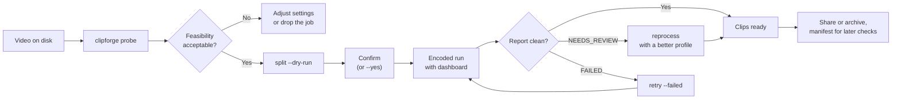
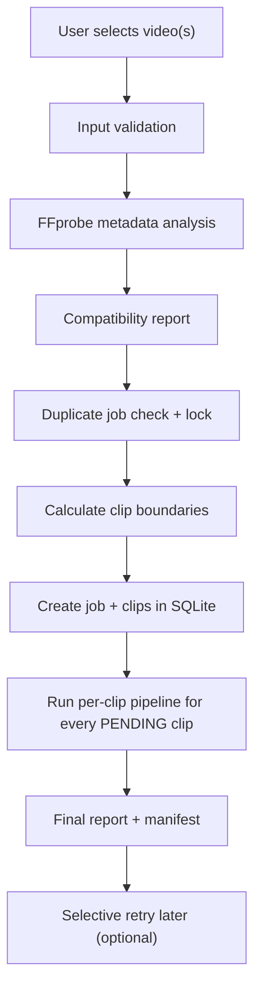
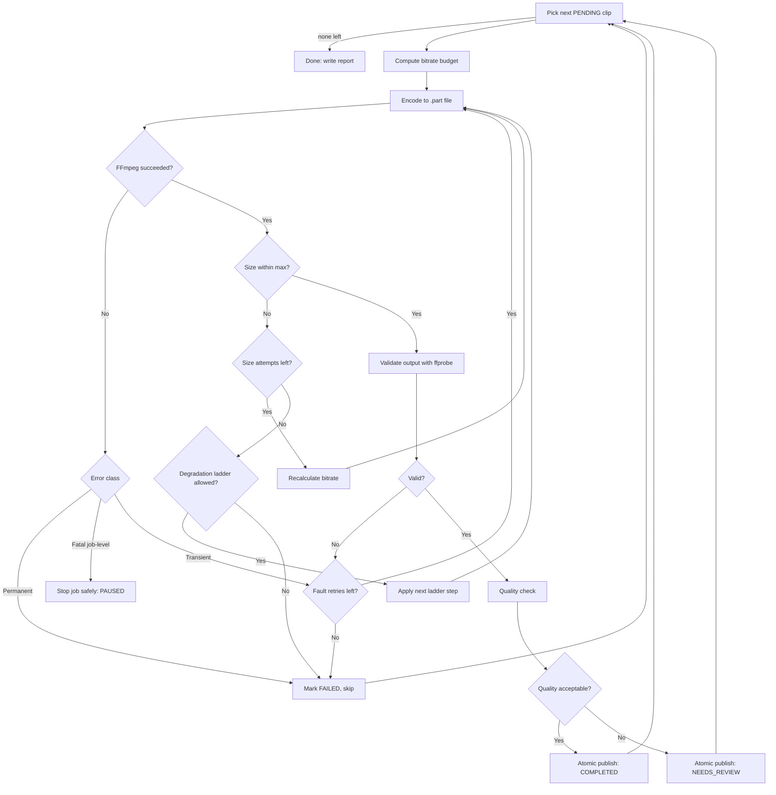
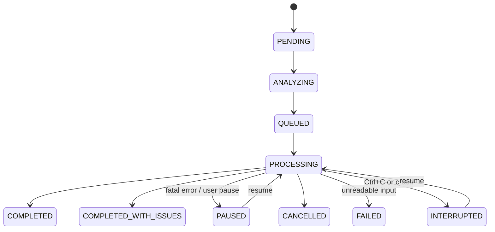
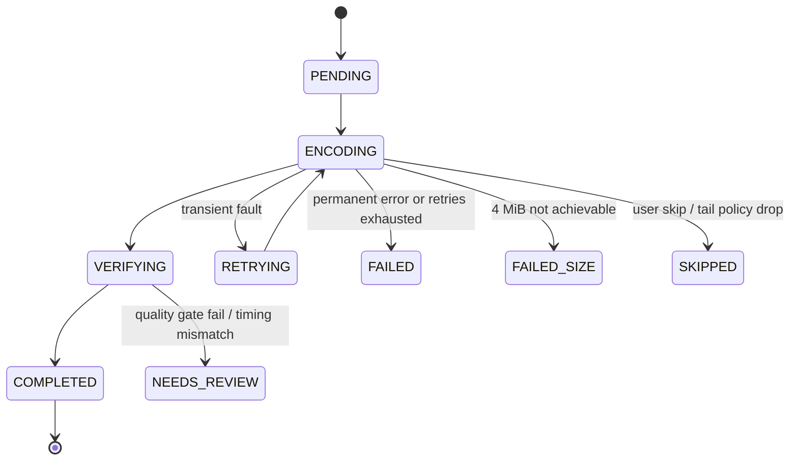
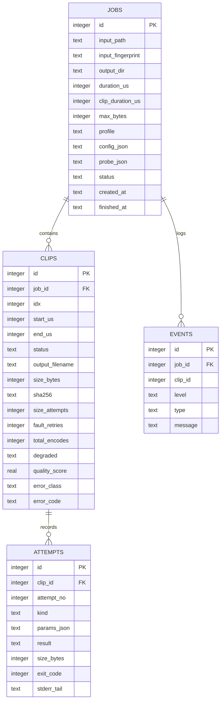
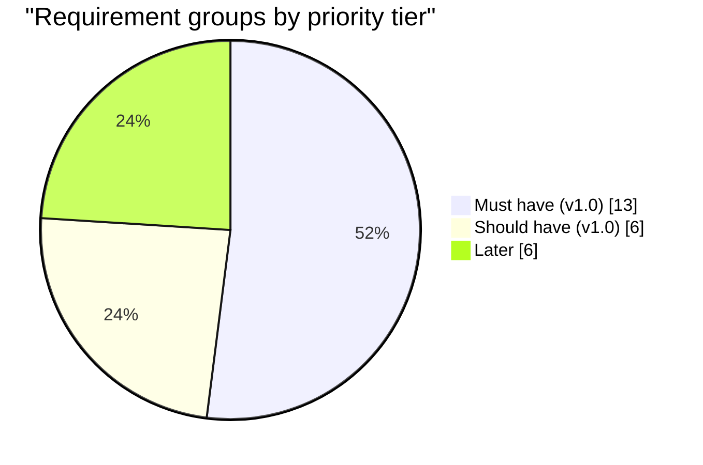

# ClipForge Product Requirements Document

| | |
|---|---|
| **Document** | PRD, version 1.0 |
| **Status** | Approved for build |
| **Owner** | Aakash |
| **Design source** | Master Blueprint v2.0 (`ClipForge_Master_Blueprint_v2.md`) |
| **Companion docs** | [README.md](README.md) |
| **Last updated** | 2026-11-12 |
| **Build status** | Phase 1 of 15 done (2026-11-14); phases tracked in [Phases.md](Phases.md) |

**How to read this document.** Every requirement carries an ID (`FR` for functional, `NFR` for non-functional) so it can be referenced in code review, tests, and changelogs. Priority values: **M** (must ship in v1.0), **S** (should ship in v1.0), **L** (later, tracked but not committed).

---

## Contents

1. [What we are building](#1-what-we-are-building)
2. [Problem statement](#2-problem-statement)
3. [Goals and non-goals](#3-goals-and-non-goals)
4. [Target users](#4-target-users)
5. [Product principles](#5-product-principles)
6. [System architecture](#6-system-architecture)
7. [Functional requirements](#7-functional-requirements)
8. [Key workflows](#8-key-workflows)
9. [Data model](#9-data-model)
10. [Non-functional requirements](#10-non-functional-requirements)
11. [Feature priority tiers](#11-feature-priority-tiers)
12. [v1.0 success metrics](#12-v10-success-metrics)
13. [Milestones](#13-milestones)
14. [Open decisions](#14-open-decisions)
15. [Out of scope and future ideas](#15-out-of-scope-and-future-ideas)

---

## 1. What we are building

ClipForge is a command-line application that takes a local video and produces fixed-length WebM clips, each one guaranteed to sit at or under 4 MiB. It runs entirely offline on the local CPU, survives crashes mid-job, and reports exactly what it did.

One sentence version: *feed it any video, get back verified 10-second WebM clips that fit under a hard size ceiling, with a manifest and report to prove it.*

| Property | Value |
|---|---|
| Product type | Offline CLI video processing tool |
| Primary platform | Arch Linux (Linux-first) |
| Language | Python 3.11+ |
| Media engine | FFmpeg and FFprobe |
| Output format | WebM (VP9 video, Opus audio) |
| Default clip length | 10 seconds |
| Size ceiling | 4 MiB per clip, hard limit |
| Failure model | Per-clip isolation, automatic retries, selective recovery |
| Interface | Typer CLI with a live terminal dashboard |
| License | GPL-3.0 |

## 2. Problem statement

Five specific problems, all experienced directly, define what this product is for.

1. **Size caps are real.** Most places people actually move small video files, from chat apps to self-hosted galleries, enforce a small per-file ceiling. A tool that produces clips "usually around 50 MB" does not help. The 4 MiB ceiling in ClipForge is a hard guarantee, not a target.
2. **Cloud converters cost more than money.** Uploading a personal video library to someone else's server means accounts, subscriptions, bandwidth, and a privacy decision on every file. For a fully local job, that tradeoff makes no sense.
3. **Generic cutters give no size promise.** They cut on keyframes and hand back whatever size results. Meeting a ceiling then becomes manual trial and error per clip.
4. **Long jobs are fragile.** A two-hour video is 720 clips. If a tool dies at clip 500 and reports nothing usable, the correct response is to never run it again. Resumability and per-clip fault isolation are requirements, not nice-to-haves.
5. **Local tools assume big hardware.** Encoding 4K with defaults can eat a low-end machine alive. The tool must run well on an Intel i3-class laptop with 8 GB RAM, with memory guards and realistic ETAs.

## 3. Goals and non-goals

### Goals

| # | Goal |
|---|---|
| G1 | Convert local video into fixed-length WebM clips, fully offline |
| G2 | Guarantee every successful clip fits the size ceiling |
| G3 | Preserve display resolution, frame rate, and color depth wherever the codec allows |
| G4 | Survive crashes, corrupt inputs, and full disks without losing finished work |
| G5 | Run stably on low-end hardware with bounded RAM and CPU load |
| G6 | Script cleanly: deterministic behavior, documented exit codes, machine-readable progress |

### Non-goals for v1.0

| # | Explicitly not building |
|---|---|
| NG1 | A graphical interface (CLI only) |
| NG2 | AI scene detection, highlight picking, or content-aware clipping |
| NG3 | Any cloud service, account, or network call at runtime |
| NG4 | Whole-video single-file conversion (a future `convert` mode, see section 15) |
| NG5 | Stream-copy cutting (it cuts on keyframes, which breaks both accuracy and the size guarantee) |
| NG6 | Gapless back-to-back playback of produced clips (independent files, Opus pre-skip) |
| NG7 | Windows or macOS support guarantees (Linux first) |
| NG8 | Parallel encoding (sequential in v1.0) |

## 4. Target users

### Personas

| Persona | Context | What they need | How ClipForge fits |
|---|---|---|---|
| **The archiver** | Keeps a personal video library on a Linux box, wants it browsable in small pieces | Reliable overnight batch conversion of long videos, no babysitting | Queue plus resume: start a 720-clip job, close the laptop lid issue aside, rerun `resume` after any interruption; finished clips are never re-encoded |
| **The sharer** | Sends clips into chat groups and forums with per-file upload caps | Clips that always pass the size check the first time | The 4 MiB hard guarantee with the 5% internal margin; `--dry-run` warns before a risky 4K job starts |
| **The scripter** | Runs conversions from cron or a pipeline on a home server | Exit codes, JSON progress, no interactive prompts by surprise | Exit codes 0/1/2/3/4/130, `--json-progress`, `--yes`, plain log mode when no TTY is attached |
| **The modest-hardware owner** | i3-class CPU, 8 GB RAM, integrated graphics | A tool that does not thrash RAM or melt the CPU | One encode at a time, 3 threads default, memory guard, thermal pause option, `benchmark` to tune profiles on real numbers |

### Who this is not for

- People who want AI to pick the interesting moments (no content analysis here; splitting is by fixed duration or configured policy).
- Video editors looking for timeline tooling. ClipForge cuts, encodes, verifies, and reports. It does not edit.
- Anyone who needs gapless playback of consecutive clips. Each clip is an independent file, and Opus pre-skip can leave a small discontinuity at the seam.

### User journey



The loop in the middle matters: a finished job with problems is not a dead end. The report names the exact command that recovers the failed or flagged clips.

## 5. Product principles

When goals conflict, this order decides. It is written down because encoding involves real tradeoffs every run.

1. **Reliability.** A finished clip is never reported as in-progress. A crash never corrupts output. Partial files are invisible to reports.
2. **Size enforcement.** A successful clip never crosses 4 MiB. No exception.
3. **Quality.** The best the size limit allows, verified with real metrics, and nothing below the quality floor counts as success.
4. **Performance.** Whatever hardware is available gets a tuned, realistic run.

The practical consequence: if a clip must choose between dropping quality and breaking the ceiling, quality drops. If it must choose between reporting failure honestly and counting a doubtful clip as done, it reports failure.

## 6. System architecture

```text
                      ┌────────────┐
                      │    CLI     │  (Typer)
                      └─────┬──────┘
                            │
              ┌─────────────▼─────────────┐
              │  FTJM                     │  scheduler, retries,
              │  fault-tolerant           │  recovery, state
              │  job manager              │  machines, locks
              └──┬──────────┬──────────┬──┘
                 │          │          │
        ┌────────▼───┐ ┌────▼─────┐ ┌──▼──────────┐
        │  Planner   │ │ Encoder  │ │  Storage    │
        │  probe +   │ │  FFmpeg  │ │  SQLite +   │
        │  boundaries│ │  wrapper │ │  manifest   │
        └────────────┘ └────┬─────┘ └─────────────┘
                            │
                   ┌────────▼────────┐
                   │    Optimizer    │  bitrate budget,
                   │  Smart Balance  │  size loop, quality
                   └─────────────────┘  gate, ladder
        Monitoring (CPU, RAM, disk, thermal) runs alongside
```

| Module | Responsibility |
|---|---|
| `cli/` | Commands, option parsing, exit codes |
| `manager/` (FTJM) | Scheduling, retry logic, error classification, recovery, locks, state machines |
| `probe/` | FFprobe wrapper, metadata, compatibility report |
| `planner/` | Boundary calculation, tail policy, feasibility estimate |
| `encoding/` | FFmpeg command builder, profiles, runner, progress parsing |
| `optimizer/` | Bitrate budget, size loop, degradation ladder, quality metrics |
| `storage/` | SQLite schema and migrations, manifest writer |
| `monitoring/` | CPU, RAM, disk, thermal sampling; Rich dashboard |
| `reporting/` | `report.json`, terminal summaries |
| `utils/` | Paths, hashing, fsync and atomic helpers, time handling |

The FTJM is the heart. It treats every clip as an independent unit, owns everything in sections 7.6 through 7.9 below, and keeps the remaining modules simple.

## 7. Functional requirements

### 7.1 Input handling (INP)

The tool accepts single files, multiple selected files, whole folders, and shell-expanded wildcards. Validation happens before any encoding, and it is honest about what an upfront check can and cannot catch: mid-file corruption only shows up during decode, so per-clip containment handles it, and the pre-check promises nothing it cannot keep.

| ID | Requirement | Priority |
|---|---|---|
| FR-INP-01 | Accept individual files, multiple files, folders, and wildcard input | M |
| FR-INP-02 | Support recursive folder scan with `--recursive` | M |
| FR-INP-03 | Validate each input before processing: file exists, readable, FFprobe parses it, a video stream exists, duration is detectable, the codec is decodable by the installed FFmpeg, output space is sufficient, and a quick integrity check passes (header, stream info, last-packet timestamp) | M |
| FR-INP-04 | Reject audio-only files with a clear message | M |
| FR-INP-05 | Contain corruption per clip during processing instead of claiming upfront detection | M |
| FR-INP-06 | Offer `--deep-scan`, a full decode pass that finds decode errors before a job starts | S |
| FR-INP-07 | Handle filenames with spaces, quotes, Unicode, and leading dashes safely (argument lists, `--`, `file:` prefix) | M |
| FR-INP-08 | Support `--start HH:MM:SS --end HH:MM:SS` to process only a range of the source | S |

**Acceptance.** A folder of mixed valid and broken files yields a job for every valid video and a clear reason for every rejected one. Nothing gets half-validated.

### 7.2 Probe and metadata analysis (PRO)

Every input gets profiled before it is planned. Phone videos, broadcast captures, and 10-bit sources all need different handling, and the report says plainly what will be preserved and what will change.

| ID | Requirement | Priority |
|---|---|---|
| FR-PRO-01 | Collect full metadata: duration, start time, coded resolution, rotation/display matrix, both FPS fields, VFR flag, codec and profile, pixel format and bit depth, color primaries/transfer/matrix, SAR and DAR, audio codec/rate/channels/layout, time base, frame count when available | M |
| FR-PRO-02 | Detect VFR by comparing `avg_frame_rate` against `r_frame_rate` | M |
| FR-PRO-03 | Produce a per-input compatibility report showing, line by line, what is preserved, converted, or applied (for example rotation baked into pixels) | M |
| FR-PRO-04 | Treat resolution preservation as display resolution: rotation is applied in pixels on re-encode, width and height may swap, and the report states it | M |
| FR-PRO-05 | Map pixel formats: 8-bit 4:2:0 stays `yuv420p` (VP9 Profile 0); 10-bit 4:2:0 becomes `yuv420p10le` (Profile 2, compatibility warning); 4:2:2 and 4:4:4 convert to 4:2:0 with the change recorded | M |
| FR-PRO-06 | Ship `--hdr keep` in v1.0 with a warning; `tonemap` arrives later | M (keep), L (tonemap) |
| FR-PRO-07 | Require confirmation before a job unless `--yes` is given | M |

**Acceptance.** A rotated phone video, a 10-bit HDR file, and a 5.1 broadcast capture each produce reports that name every change before anything is encoded.

### 7.3 Splitting engine (SPL)

Boundaries are computed in integer microseconds, never float seconds, so a 360-clip job lands frame-exact at the end instead of drifting. Intervals are half-open: `[start, end)`. A frame sitting exactly on a boundary belongs to the next clip, which removes both duplicate and missing frames.

| ID | Requirement | Priority |
|---|---|---|
| FR-SPL-01 | Default clip duration of 10 s; `--duration` validated from 1 to 600 s | M |
| FR-SPL-02 | Compute clip count as `ceil(duration / clip_duration)` with the tail policy applied | M |
| FR-SPL-03 | Calculate boundaries in integer microseconds (or source time-base ticks), as half-open intervals | M |
| FR-SPL-04 | Cut with input-seek plus re-encode for frame accuracy; never stream copy | M |
| FR-SPL-05 | Offer `--seek-mode accurate` (decode from start) as a fallback for slow-seek containers such as TS, AVI, FLV, MPEG | S |
| FR-SPL-06 | Implement tail policy `keep`, `merge_into_previous`, or `drop` with `min_tail_seconds` (default 1.0) so a 0.2 s orphan tail never becomes a clip | M |
| FR-SPL-07 | Default `--fps-mode preserve` (WebM carries VFR); offer `cfr` for players that want constant rate; A/V sync verification is mandatory in both modes | M |
| FR-SPL-08 | Verify each clip after encode: duration and frame count within one frame of expected. A mismatch counts as a transient fault; a mismatch that survives retries marks the clip `NEEDS_REVIEW` | M |
| FR-SPL-09 | Document in help text that consecutive clips are independent files and gapless playback is not guaranteed | M |

**Acceptance.** Boundary unit tests cover tail cases, non-zero start times, and VFR flags. A 600.2 s video produces no 0.2 s clip under the default policy.

### 7.4 Encoding engine (ENC)

| ID | Requirement | Priority |
|---|---|---|
| FR-ENC-01 | Encode to WebM with VP9 (`libvpx-vp9`) video and Opus (`libopus`) audio, software encoding | M |
| FR-ENC-02 | Provide three profiles: `fast` (`-cpu-used 4`, one pass), `balanced` (`-cpu-used 2`, one pass CQ), `best` (`-cpu-used 1`, two passes) | M |
| FR-ENC-03 | Apply common settings: `-row-mt 1`, threads defaulting to 3, tile columns scaled to resolution, `-auto-alt-ref 1`, and `lag-in-frames` reduced at 4K to hold RAM down | M |
| FR-ENC-04 | Set the keyframe interval at or above the clip's frame count; a 10 s clip needs no interior keyframes and every saved one is budget | M |
| FR-ENC-05 | Budget audio per channel count: mono 40 kbps, stereo 64, 5.1 at 160, 7.1 at 224. A video with no audio gets no audio budget | M |
| FR-ENC-06 | Offer `--audio-channels keep\|stereo`; downmixing to stereo is encouraged on tight budgets since 5.1 costs about 5% of the clip budget by itself | M |
| FR-ENC-07 | Encode sequentially, one clip at a time, by default | M |
| FR-ENC-08 | Keep hardware acceleration off by default; `--hw-accel auto\|vaapi\|off` with automatic fallback to software when support is absent or a run fails | S |

**Acceptance.** `doctor` detects the codec situation; the three profiles produce measurably different time and size results in `benchmark`.

### 7.5 Size and quality optimization (OPT)

This is where the product promise lives. The hard limit is 4,194,304 bytes. Aiming exactly at it is fragile because containers add overhead and encoders overshoot, so every clip targets 5% lower (3,984,589 bytes, about 3.80 MiB), with audio subtracted first:

```text
target_bytes  = 4,194,304 × (1 − 0.05)                = 3,984,589
audio_bytes   = audio_bps × duration ÷ 8
video_bps     = (target_bytes − audio_bytes) × 8 ÷ duration
```

Feasibility is estimated before any encode via bits per pixel per frame (`bpp = video_bps ÷ (width × height × fps)`), so `--dry-run` can warn that a 4K 60 fps source (about 0.006 bpp at the standard budget) is a hard job while 1080p 30 fps (about 0.050) is comfortable.

| ID | Requirement | Priority |
|---|---|---|
| FR-OPT-01 | Enforce 4,194,304 bytes as a hard limit on every successful clip | M |
| FR-OPT-02 | Target the 5%-margin internal budget; the hard limit never moves | M |
| FR-OPT-03 | Derive the video bitrate from the budget with audio subtracted first | M |
| FR-OPT-04 | Show per-video feasibility estimates in `--dry-run`, with clip count | M |
| FR-OPT-05 | Encode in constrained-quality mode (CRF plus a bitrate ceiling), so simple clips may land under budget and that is treated as a good outcome | M |
| FR-OPT-06 | Retry oversize results with a recalculated bitrate, always at least 3% lower than the previous attempt, up to 4 size attempts | M |
| FR-OPT-07 | Promote a clip to two-pass rate control after two oversize results | M |
| FR-OPT-08 | Gate quality in tiers: tier 0 size and ffprobe validity (always), tier 1 SSIM or PSNR (default on), tier 2 VMAF (optional, needs `libvmaf`); configurable via `--quality-metric none\|ssim\|psnr\|vmaf` | M (tiers 0-1), S (VMAF) |
| FR-OPT-09 | Allow metric sampling with `--quality-sample N`, for example VMAF on every fifth clip | S |
| FR-OPT-10 | Keep configurable quality thresholds (starting values: SSIM at 0.95, VMAF at 80, calibrated later); a clip that fails its gate is kept on disk and marked `NEEDS_REVIEW`, never counted complete | M |
| FR-OPT-11 | Handle under-use: output far below budget that still fails the quality gate earns one attempt at a lower CRF | S |
| FR-OPT-12 | Implement the degradation ladder behind `--on-oversize fail\|fps\|downscale\|both`, default `fail`: step 1 halves FPS on sources of 48 fps or more, step 2 downscales one standard step (2160 to 1440 to 1080 to 720, aspect kept); every degradation is recorded in manifest and report | M (fail policy), S (ladder steps) |
| FR-OPT-13 | Cap total FFmpeg runs per clip at 8 across all causes; exhaustion marks `FAILED_LIMIT` | M |

**Acceptance.** Every fixture, including the noise-stressed worst case, ends with either a clip inside the limit or an honest failure status. No path exists that publishes an oversize file as complete.

### 7.6 Fault tolerance (FT)

| ID | Requirement | Priority |
|---|---|---|
| FR-FT-01 | Treat each clip as the failure unit: one clip failing never stops the job | M |
| FR-FT-02 | Retry faults on a fixed schedule: 1 initial attempt plus up to 3 retries, waiting 2, 5, then 10 seconds | M |
| FR-FT-03 | Adapt retries to the error: suspected out-of-memory lowers threads and frame lag; a hardware encoder failure falls back to software VP9; a signal kill retries unchanged | S |
| FR-FT-04 | Classify every error into four classes with fixed actions: tunable (optimizer handles it), transient (retry), permanent clip (no retry, mark `FAILED`, continue), fatal job (pause safely, protect completed clips) | M |
| FR-FT-05 | Classify from FFmpeg exit codes and stderr patterns, with patterns kept in one module for easy extension | M |
| FR-FT-06 | Offer `--tolerate-corruption`: one lenient attempt with `-err_detect ignore_err` for clips in a corrupt region, result marked `NEEDS_REVIEW` | S |
| FR-FT-07 | Run every encode under a watchdog of `max(60 s, clip duration × timeout_factor)`; terminate with SIGTERM, then SIGKILL after 5 seconds, and count a transient fault | M |
| FR-FT-08 | Detect stalls by watching progress from `-progress pipe:1`; no progress for N seconds counts as a fault | S |

**Acceptance.** A `kill -9` on a running FFmpeg costs one clip one retry, and the job continues. A deliberately truncated fixture fails only the clips that touch the corrupt region.

### 7.7 Pause, resume, recovery (RES)

| ID | Requirement | Priority |
|---|---|---|
| FR-RES-01 | Handle Ctrl+C gracefully: stop starting new clips, terminate the active FFmpeg process group, remove the active `.part` file, leave completed clips untouched, commit `INTERRUPTED`, exit 130; a second Ctrl+C exits immediately and recovery happens on the next start | M |
| FR-RES-02 | On resume: load the job, verify the input fingerprint, quick-verify completed clips, reset clips with missing or invalid files to `PENDING`, clean orphan `.part` files, reset interrupted clips to `PENDING`, leave `FAILED` clips alone, process the rest | M |
| FR-RES-03 | Refuse resume when the input fingerprint changed; accept `--relocate /new/path` when the fingerprint matches after a move | M |
| FR-RES-04 | Never re-encode a completed clip during resume; `FAILED` clips need an explicit `retry --failed` | M |
| FR-RES-05 | Publish atomically: encode into `<output_dir>/.clipforge_tmp/clip_NNNN.webm.part`, verify, `fsync`, then `os.replace()`; a `.part` file can never appear as complete | M |
| FR-RES-06 | Hold an `flock` per output folder so a second process on the same job fails fast; detect duplicate jobs by fingerprint plus output folder plus config and prompt resume, new, or cancel | M |
| FR-RES-07 | Check disk space before a job (`clip_count × max_bytes × 1.05` plus temp margin) and before each clip at runtime; dropping below threshold pauses the job with completed clips intact | M |
| FR-RES-08 | Support `--deep-verify`, a full decode check of every clip, on top of the default quick verification | S |

**Acceptance.** Interrupt a 60-clip job at any point, resume, and the result matches an uninterrupted run with zero duplicate encodes and zero missing clips.

### 7.8 Selective reprocessing (REP)

| ID | Requirement | Priority |
|---|---|---|
| FR-REP-01 | Retry failed clips only: `clipforge retry <job> --failed` | M |
| FR-REP-02 | Retry review clips with a different profile: `retry <job> --needs-review --profile best` | M |
| FR-REP-03 | Re-encode specific clips: `reprocess <job> --clip 17` or a range `--clips 17-25`, requiring explicit confirmation or `--force` for completed clips | M |
| FR-REP-04 | Verify a whole job: `verify <job>` with `--deep` for full decode | M |
| FR-REP-05 | Replace safely: the new output is built and verified in a `.part` file before it takes the old clip's place; a failed replacement leaves the old clip untouched | M |
| FR-REP-06 | Keep the original input file untouched always; refuse reprocessing when it is missing or changed | M |
| FR-REP-07 | Append every reprocess as a new `attempts` record with kind `reprocess`; history is never deleted | M |

**Acceptance.** A job ending with one failed clip and one review clip is fully recovered by two commands, with the report confirming the new state.

### 7.9 Persistence (PER)

| ID | Requirement | Priority |
|---|---|---|
| FR-PER-01 | Store all job state in SQLite with WAL journaling, foreign keys on, `synchronous=NORMAL`, and schema versioning with migrations | M |
| FR-PER-02 | Keep four tables: `jobs` (input path, fingerprint, output dir, boundaries, config snapshot, probe summary, status), `clips` (one row per clip with boundaries, status, size, SHA-256, all three counters, degradation, quality, error class, code, and message), `attempts` (one row per encode with parameters, result, size, exit code, and a bounded 2 KB stderr tail), `events` (timestamped state changes) | M |
| FR-PER-03 | Commit every state change in a single transaction before the file rename happens | M |
| FR-PER-04 | Store the input fingerprint as size plus SHA-256 of the first, middle, and last 1 MiB | M |
| FR-PER-05 | Keep the database small: full FFmpeg stderr lives in per-job logs, only a bounded tail is stored | M |
| FR-PER-06 | Allow `verify` to rebuild job state from `manifest.json` and the files on disk if the database is damaged | S |

**Acceptance.** Kill the process mid-transaction and the database opens consistently on the next run. Delete the database and `verify` reconstructs a usable state from the manifest.

### 7.10 CLI (CLI)

| ID | Requirement | Priority |
|---|---|---|
| FR-CLI-01 | Ship the command set: `info`, `doctor`, `probe`, `split`, `batch`, `queue`, `status`, `resume`, `retry`, `reprocess`, `verify`, `cancel`, `report`, `config`, `benchmark`, `clean` | M (core), S (queue, benchmark) |
| FR-CLI-02 | Use documented exit codes: 0 all clips completed, 1 finished with failed or review clips, 2 usage error, 3 dependency missing, 4 fatal error, 130 interrupted | M |
| FR-CLI-03 | Run every subprocess from an argument list, never a shell string; sanitize filenames | M |
| FR-CLI-04 | Provide shell completion through Typer | S |
| FR-CLI-05 | Support the documented option set (`--duration`, `--max-size`, `--output`, `--profile`, `--on-oversize`, `--quality-metric`, `--audio-channels`, `--tail-policy`, `--fps-mode`, `--hdr`, `--threads`, `--hw-accel`, `--start/--end`, `--no-audio`, `--recursive`, `--yes`, `--dry-run`, `--no-dashboard`, `--json-progress`) | M |

**Acceptance.** Every command exits with a code a script can act on, and `--help` for each command is complete without reading the source.

### 7.11 Terminal dashboard (DASH)

| ID | Requirement | Priority |
|---|---|---|
| FR-DASH-01 | Show a Rich live dashboard, adaptive to terminal size, with progress, ETA, current clip, attempt counters, size versus budget, and system vitals | S |
| FR-DASH-02 | Keep the counter invariant: `completed + active + pending + failed + review = total` | M |
| FR-DASH-03 | Fall back to plain log lines when stdout is not a TTY, and honor `--no-dashboard` | M |
| FR-DASH-04 | Emit machine-readable progress with `--json-progress` | S |

**Acceptance.** Piping output into a file never produces broken box-drawing artifacts, and the counters always add up.

### 7.12 Configuration (CFG)

| ID | Requirement | Priority |
|---|---|---|
| FR-CFG-01 | Read one YAML file at `~/.config/clipforge/config.yaml`; precedence is CLI flags over config file over built-in defaults | M |
| FR-CFG-02 | Validate with pydantic and fail on a wrong value with a clear message naming the key | M |
| FR-CFG-03 | Ship documented defaults for every key (clip duration, tail policy, margin, profile, oversize policy, quality metric and thresholds, retry schedule, timeout factor, threads, hardware acceleration, RAM limit, thermal pause, paths) | M |

### 7.13 Logs, manifest, reports (LOG)

| ID | Requirement | Priority |
|---|---|---|
| FR-LOG-01 | Write rotating `application.log` and `errors.log` under `~/.local/state/clipforge/logs/`, plus one detailed log per job | M |
| FR-LOG-02 | Log per clip: start, each attempt with parameters and result, error class and code, final status | M |
| FR-LOG-03 | Write `manifest.json` in the output folder, updated atomically after every clip, containing per-clip index, file, time range, size, SHA-256, status, attempt counters, degradation, and quality score | M |
| FR-LOG-04 | Write `report.json` at job end: expected, completed, review, and failed counts, failure details, total encodes, largest clip, total time, degraded count | M |
| FR-LOG-05 | End every run with a terminal summary that names the exact command for any needed recovery | M |

### 7.14 Privacy and safety (SEC)

| ID | Requirement | Priority |
|---|---|---|
| FR-SEC-01 | Make no network requests at runtime; no telemetry of any kind | M |
| FR-SEC-02 | Treat the input file as read-only; never move, modify, or delete it | M |
| FR-SEC-03 | Refuse jobs where input and output paths overlap; block path traversal out of the chosen output folder | M |
| FR-SEC-04 | Restrict database and logs to user-only permissions (0600 files, 0700 directories) | M |
| FR-SEC-05 | Keep logs local-only | M |

### 7.15 Diagnostics and benchmarking (BEN)

| ID | Requirement | Priority |
|---|---|---|
| FR-BEN-01 | `doctor` detects FFmpeg, FFprobe, libvpx, libopus, libvmaf, and VAAPI capability, and reports supported input formats for the installed build | M |
| FR-BEN-02 | `benchmark` encodes a few sample clips of a given file across profiles and thread counts, reporting time, size, RAM, and temperature | S |

## 8. Key workflows

### Job level



### Per clip



The absolute cap of 8 total encodes per clip applies no matter how the loop spends them, so a runaway loop is structurally impossible.

### State machines

Job:



Clip:



A job ending with any failed or review clips reports `COMPLETED_WITH_ISSUES` and exits 1. Clips found mid-flight after a crash reset to `PENDING` with their `.part` files cleaned.

## 9. Data model



The fingerprint column is what makes resume safe: if the source file changed between runs, the job refuses to continue against different bytes. The `attempts` table is append-only, which is why every reprocess leaves a traceable history.

## 10. Non-functional requirements

| ID | Requirement | Priority |
|---|---|---|
| NFR-01 | Never publish a corrupted, partial, or mislabeled file as complete | M |
| NFR-02 | Keep 100% of reported-complete clips at or under the size ceiling on every fixture and every real job | M |
| NFR-03 | Hold peak RAM near 1 to 1.5 GB on 1080p sources; never load a whole video into memory; guard memory at 4K | M |
| NFR-04 | Run with zero network access at runtime | M |
| NFR-05 | Stay stable on an i3-1215U class CPU with 8 GB RAM, including thermal-aware pausing | M |
| NFR-06 | Bound log and database growth (rotation, bounded stderr tails) | M |
| NFR-07 | Show realistic ETAs based on actual encode progress | M |
| NFR-08 | Make every error message state what happened, what it means, and what command to run next | M |
| NFR-09 | Store everything under XDG paths so an installed CLI behaves correctly on any system | M |
| NFR-10 | Keep CLI behavior deterministic and scriptable: same input and config produce the same plan | M |

## 11. Feature priority tiers



| Tier | Scope |
|---|---|
| Must have | Fully offline operation, 10 s default splitting with frame-accurate boundaries, WebM output, hard 4 MiB limit with margin, Smart Balance with size loop and quality gate, metadata analysis with compatibility report, SQLite job database with resume and crash recovery, fault-tolerant processing with retries and skip and error classification, atomic publish, selective retry and `verify`, sequential batch processing, manifest, logs and final report, `doctor`, `probe`, `split --dry-run` |
| Should have | Rich terminal dashboard, resource and thermal monitoring, VMAF metric, hardware capability detection and `benchmark`, degradation ladder steps, HDR tonemap |
| Later | Parallel encoding, AV1 (SVT-AV1) profile, scene-aware splitting, plugin architecture, portable distribution, `convert` mode |

Reliability persistence (SQLite and resume) sits in the must tier deliberately. A splitter without resumability fails the problem statement in section 2.

## 12. v1.0 success metrics

The release is judged against these, all measurable from fixtures and scripted runs:

| # | Metric | Bar |
|---|---|---|
| SM-1 | Size compliance | 100% of reported-complete clips at or under 4 MiB |
| SM-2 | Resume integrity | Interrupt at any point, resume, and the output matches an uninterrupted run: zero duplicate encodes, zero missing clips |
| SM-3 | Corruption containment | One corrupt region fails only the clips that touch it; the rest complete |
| SM-4 | Standard job | A 10-minute 1080p30 video produces 60 playable clips, every one within the limit |
| SM-5 | Resource ceiling | Peak RAM on the 1080p fixture stays within the target |
| SM-6 | Reporting consistency | `report.json`, `manifest.json`, and the database agree on every job |
| SM-7 | Scriptability | Every command exits with the documented code for its outcome |

## 13. Milestones

Each milestone ends with a tool that actually runs.

| # | Milestone | Delivers | Done when |
|---|---|---|---|
| M0 | Setup | Repo, pyproject, Typer skeleton, `doctor` | `doctor` detects FFmpeg, FFprobe, libvpx, libopus |
| M1 | Probe and planner | `probe`, `split --dry-run` | Boundary unit tests pass: tail, VFR flags, non-zero start time |
| M2 | MVP encode | One video to clips, basic size check and retry, no database | 10-min test video yields 60 clips, all within the limit |
| M3 | Optimizer | Budget, CQ mode, size loop, two-pass fallback, ladder, SSIM gate | Predictable behavior on noisy and 4K fixtures, caps enforced |
| M4 | Persistence | SQLite, state machines, atomic publish, manifest, resume | Ctrl+C then resume with zero duplicate encodes |
| M5 | Fault tolerance | Error classifier, fault retries, watchdog, `retry`, `reprocess`, `verify` | Kill-test and corrupt-test pass |
| M6 | Batch, queue, dashboard | `batch`, `queue`, Rich dashboard, locks | Multi-video job stable |
| M7 | Performance | Resource monitor, thermal guard, `benchmark`, profile tuning | Defaults finalized from real measurements |
| M8 | Hardening | Full test matrix, docs, error message polish | Section 12 metrics pass |
| M9 | Packaging | PKGBUILD, pipx, man page, completion | Clean install on Arch |

Dependency order: M0 and M1 are pure logic and everything stands on them, so they come first. M4 is deliberately early because every later milestone builds on real persistence.

## 14. Open decisions

These need a call before or during the relevant milestone. Recommendations come from the blueprint.

| # | Decision | Recommendation |
|---|---|---|
| D1 | Which platform or use drives the 4 MiB limit (messaging app, forum, gallery, something else)? Names the exact constraint and may tune margin and defaults | State the target |
| D2 | Default `--on-oversize` policy | `fail`, consistent with the preservation goal |
| D3 | Default tail policy | `merge_into_previous` with `min_tail_seconds: 1.0` |
| D4 | HDR handling in v1.0 | `keep` plus warning; tonemap later |
| D5 | Default audio channel policy | `keep`, with a stereo suggestion on tight clips |
| D6 | Default quality metric | SSIM on every clip, VMAF optional and sampled |
| D7 | Output naming | `clip_0001.webm` per video folder in batch mode |
| D8 | Behavior when an existing output folder is found | Ask resume, new, or overwrite; refuse in non-interactive mode |
| D9 | Default output location | `./<video_name>/` in the current directory |
| D10 | Hardware acceleration default | Off, with `doctor` reporting capability |
| D11 | 4:2:2 and 4:4:4 sources | Convert to 4:2:0 and record the change |
| D12 | Starting encode profile | `balanced`, finalized after `benchmark` on the i3 |
| D13 | Naming and license already settled: ClipForge, GPL-3.0 | Done, FFmpeg build licensing noted in `doctor` |

## 15. Out of scope and future ideas

Ideas tracked for after v1.0, in no committed order:

- **Parallel encoding.** The queue design keeps the option open, but v1.0 is sequential for memory safety.
- **AV1 profile.** SVT-AV1 often beats VP9 at the same size; worth an optional profile once the core is stable.
- **Scene-aware splitting.** Cut on detected scene changes instead of fixed duration, as an alternative policy.
- **`convert` mode.** Whole-video single-file WebM with a size cap, reusing the entire optimizer.
- **Plugin architecture.** A clean seam for community filters and output formats.
- **Portable distribution.** A self-contained build beyond the Arch package and pipx.

---

*This PRD summarizes and formalizes the Master Blueprint v2.0. Where the two documents ever disagree, the blueprint's corrected v2 rules (retry counts, counters, schema, paths) are authoritative, and this document gets updated.*
