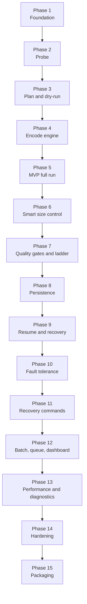

# ClipForge Build Phases

| | |
|---|---|
| **Document** | Phases, version 1.0 |
| **Status** | Active build plan |
| **Owner** | Aakash |
| **Sources** | Master Blueprint v2.0 (roadmap M0-M9), [PRD.md](PRD.md), [ARCHITECTURE.md](ARCHITECTURE.md), [Rules.md](Rules.md) |
| **Last updated** | 2026-11-13 |

This document turns the blueprint's ten milestones into fifteen phases, each small enough to finish in one focused stretch of work and each leaving the tool able to do something it could not do before. The PRD's milestone table stays the contract; this file is the working schedule that fills it.

The rule that keeps the project from turning into a mess sits above every phase: **a phase is done when its "done when" list passes, and the next phase does not start until it does.** Half-finished phases are how projects rot.

---

## Contents

1. [How the phases work](#1-how-the-phases-work)
2. [Phase map at a glance](#2-phase-map-at-a-glance)
3. [The phases](#3-the-phases)
4. [Session discipline](#4-session-discipline)

---

## 1. How the phases work

### 1.1 The shape of every phase

Each phase below follows the same template:

| Field | Meaning |
|---|---|
| Goal | One line: what this phase is for |
| Build | The concrete work: which files, which functions, what behavior |
| Requirements | The FR and NFR IDs from the PRD that this phase makes real |
| Rules that bite | The Rules.md entries most likely to matter here |
| Done when | The testable exit condition. No passing, no next phase |
| The tool after this phase | What you can actually run by hand when it is over |
| Out of scope | The tempting things that belong to a later phase, named so they do not sneak in |
| Load | Relative size: light, medium, or heavy. Heavy phases may span several sessions, but never change their done-when |

### 1.2 Definition of done, for every phase

These apply to all fifteen phases without being repeated in each one:

- [ ] All tests pass, including the new ones this phase adds
- [ ] ruff and mypy run clean on the whole package
- [ ] The new capability was exercised by hand on a real fixture, not just in tests
- [ ] PRD.md and ARCHITECTURE.md reflect anything the phase decided differently than written
- [ ] Commit messages cite the FR IDs served (RULE-01)
- [ ] No fixtures, `.part` files, or media entered git (RULE-35)

### 1.3 The three temptations

Named upfront because each one has killed plans like this before:

1. **Pulling future work in early.** SQLite in phase 5 would feel useful. It is deliberately delayed to phase 8 so the MVP stays simple and every persistence bug lands against a stable encode loop. Resist the pull.
2. **Starting the next phase on a red suite.** A failing test from the previous phase does not become tomorrow's problem. It blocks.
3. **Growing a phase instead of splitting it.** If a done-when list keeps failing after two honest attempts, the phase is mis-sized: split it, update this file, move on.

### 1.4 Phase dependency chain

The chain is linear on purpose. One exception is allowed: Phase 13 (performance sampling) can be built in parallel with Phase 12 if the hardware numbers are needed early, because the sampler touches nothing the dashboard depends on.

## 2. Phase map at a glance

| Phase | Name | Blueprint milestone | Load | The tool can do |
|---|---|---|---|---|
| 1 | Foundation | M0 | light | Report its own health |
| 2 | Probe | M1 (first half) | medium | Read any video and report what it is |
| 3 | Plan and dry-run | M1 (second half) | medium | Show the full job plan before encoding anything |
| 4 | Encode engine | M2 (first half) | medium | Encode one clip, correctly, under supervision |
| 5 | MVP full run | M2 (second half) | medium | Turn a video into 60 real clips |
| 6 | Smart size control | M3 (first half) | medium | Win the fight for 4 MiB on hard clips |
| 7 | Quality gates and ladder | M3 (second half) | medium | Refuse to call a bad clip good |
| 8 | Persistence | M4 (first half) | heavy | Survive anything and remember it |
| 9 | Resume and recovery | M4 (second half) | medium | Continue exactly where a crash happened |
| 10 | Fault tolerance | M5 (first half) | medium | Absorb failures without spreading them |
| 11 | Recovery commands | M5 (second half) | medium | Repair a damaged job from the command line |
| 12 | Batch, queue, dashboard | M6 | medium-heavy | Process a folder while you watch |
| 13 | Performance and diagnostics | M7 | light-medium | Tune itself to the machine it runs on |
| 14 | Hardening | M8 | medium | Prove the PRD's success metrics |
| 15 | Packaging | M9 | light | Install like a real Arch tool |

Phases 1 to 3 are the blueprint's suggested first stretch of coding. Take them one at a time anyway; each ends with something runnable.

## 3. The phases

### Phase 1: Foundation

**Goal.** A real, installable package skeleton with a working CLI and a diagnostic command, so every later phase builds on ground that exists.

**Build.**

| Work item | File | Detail |
|---|---|---|
| Package layout | `src/clipforge/**` | Create every module directory from the architecture tree with `__init__.py`. Empty is fine; real is not optional |
| Packaging | `pyproject.toml` | PEP 621 metadata, dependencies (typer, pydantic, pyyaml, rich, psutil), console script `clipforge`, tool config for ruff and mypy |
| Constants | `core/constants.py` | State names, the caps (4 size attempts, 3 fault retries, 8 total encodes), the 4 MiB limit, the 5% margin, exit codes 0/1/2/3/4/130, the 2/5/10 s retry delays |
| Exceptions | `core/errors.py` | The full hierarchy: base, usage, dependency, fatal job, transient fault, permanent clip error |
| Config | `core/config.py` | pydantic model with every key from the blueprint's config section, YAML load, CLI-over-file-over-defaults precedence |
| CLI skeleton | `cli/main.py`, `cli/commands/*` | Typer app with all 16 commands registered. Unbuilt commands print which phase will deliver them and exit 2 |
| Doctor | `cli/commands/doctor.py` | The one real command: detect ffmpeg, ffprobe, libvpx-vp9, libopus, libvmaf, VAAPI; list supported input formats of the installed build |
| Info | `cli/commands/info.py` | Version, Python version, platform |
| Tests | `tests/unit/test_config.py`, `tests/unit/test_doctor.py` | Config precedence; doctor against a mocked subprocess |

**Requirements.** FR-BEN-01, FR-CLI-01 (skeleton), FR-CFG-01/02/03, NFR-09.

**Rules that bite.** RULE-05 (argument lists, from the first subprocess call), RULE-13 (no bare excepts), RULE-28 (type hints from day one), RULE-33 (no dead code: no stub bodies that pretend to work).

**Done when.** `pip install -e .` succeeds; `clipforge doctor` runs against the real installed stack and reports truthfully; `clipforge --help` lists all 16 commands; config precedence test passes; mypy and ruff are clean.

**The tool after this phase.** It knows what is installed on the machine and says so. That sounds small; it is the command every future bug report starts with.

**Out of scope.** Any media handling. Doctor inspects, never encodes.

**Load.** Light.

---

### Phase 2: Probe

**Goal.** Understand any input file completely before planning anything about it.

**Build.**

| Work item | File | Detail |
|---|---|---|
| FFprobe wrapper | `probe/ffprobe.py` | Run ffprobe with JSON output through an argument list; parse; report failures as typed errors. Filename defense per RULE-06 |
| Metadata model | `probe/metadata.py` | `ProbeData` with every field the PRD lists: duration, start time, coded resolution, rotation matrix, both FPS fields, VFR flag, codec and profile, pixel format and bit depth, color triplet, SAR and DAR, audio codec, rate, channels, layout, time base, frame count when present |
| Compatibility report | `probe/compatibility.py` | Line-by-line preserved, converted, or applied verdicts. The bpp feasibility line arrives in phase 3; the report structure lands now |
| Probe command | `cli/commands/probe.py` | Wire it up. Run the input validation checklist from FR-INP-03: exists, readable, parses, has a video stream, duration known, codec decodable, quick integrity (header, stream info, last-packet timestamp) |
| Rejections | `cli/commands/probe.py` | Audio-only files and unreadable files rejected with specific messages |
| Tests | `tests/unit/test_metadata.py`, `tests/integration/test_probe.py` | Normalization against recorded ffprobe JSON; live runs against lavfi-generated fixtures |

**Requirements.** FR-PRO-01, FR-PRO-02, FR-PRO-03, FR-INP-03 (the validation half), FR-INP-04, FR-INP-07.

**Rules that bite.** RULE-05/06 (subprocess safety), RULE-20 (no printing in library code), RULE-34 (metadata normalization is pure and unit-tested).

**Done when.** `clipforge probe` on a 1080p30 fixture prints full metadata plus a compatibility report; an audio-only file is refused with a message that says why; a truncated fixture is caught by the quick integrity check; a filename with spaces and a leading dash both probe correctly.

**The tool after this phase.** Hand it any video and it tells you what it is and what would change in conversion. Still no encoding.

**Out of scope.** Splitting decisions (phase 3), deep scan (phase 11 adds the flag; the probe is ready for it).

**Load.** Medium.

---

### Phase 3: Plan and dry-run

**Goal.** Make the whole job visible on paper: boundaries, tail, audio cost, feasibility. Nothing encodes yet; everything gets decided.

**Build.**

| Work item | File | Detail |
|---|---|---|
| Boundary math | `planner/boundaries.py` | Integer microseconds, half-open `[start, end)` intervals, source start-time offset honored. Pure functions |
| Tail policy | `planner/tail.py` | `keep`, `merge_into_previous`, `drop` against `min_tail_seconds`. A 600.2 s video must not plan a 0.2 s clip |
| Budget math | `optimizer/budget.py` | Target bytes (4,194,304 minus 5%), audio subtraction, video bitrate derivation. The worked example is the unit test: stereo 64 kbps, 10 s, gives about 3,123,671 bps |
| Feasibility | `planner/feasibility.py` | bpp formula, mapped to comfortable (0.04+), tight (0.02 to 0.04), risky (below 0.02) |
| Dry-run | `cli/commands/split.py` | `--dry-run` prints: clip count, per-class boundary summary, tail decision, audio budget by channel count, feasibility verdict, estimated total output size |
| Range option | `cli/commands/split.py` | `--start` and `--end` restrict planning to a source range (FR-INP-08), cheap to add while the planner is open |
| Tests | `tests/unit/test_boundaries.py`, `tests/unit/test_tail.py`, `tests/unit/test_budget.py` | The heaviest unit test investment of the project, per RULE-34 |

**Requirements.** FR-SPL-01, FR-SPL-02, FR-SPL-03, FR-SPL-06 (planning side), FR-OPT-02, FR-OPT-03, FR-OPT-04, FR-INP-08.

**Rules that bite.** RULE-23 (integer microseconds, half-open), RULE-29 (pure functions, no I/O), RULE-34 (this is the test-first phase).

**Done when.** `split --dry-run` on a 10-minute fixture reports 60 clips and a comfortable verdict; on the noise fixture it reports tight or risky; the 600.2 s tail case plans no orphan clip; boundaries hold across a non-zero source start time; the budget test reproduces the blueprint's worked example to the byte.

**The tool after this phase.** The full blueprint stretch M0 plus M1 is standing: probe, plan, dry-run. First honest go/no-go decisions happen here, before any CPU time is spent.

**Out of scope.** Any encode. If the dry-run makes you want to see a clip, that is phase 4 talking; finish the suite first.

**Load.** Medium, weighted toward tests rather than code.

---

### Phase 4: Encode engine

**Goal.** Encode a single clip correctly, under supervision, with the watchdog and the kill ladder, as a tested unit.

**Build.**

| Work item | File | Detail |
|---|---|---|
| Profiles | `encoding/profiles.py` | fast, balanced, best as concrete settings tables, plus shared settings (`-row-mt 1`, tile columns by resolution, `-auto-alt-ref 1`, adaptive `lag-in-frames`) |
| Command builder | `encoding/builder.py` | Assemble the full argument list for one clip from profile, budget, probe data, and config: input seek, duration, maps, codecs, pixel format, output `.part` path |
| Runner | `encoding/runner.py` | Spawn with `subprocess`, argument list, enforced watchdog of `max(60 s, duration × timeout_factor)`, SIGTERM then SIGKILL after 5 s, structured result (exit code, size, bounded stderr tail) |
| Progress parser | `encoding/progress.py` | Parse `-progress pipe:1` frames; expose time and frame position; stall detection comes with the FTJM in phase 10, the parser lands now |
| Keyframe rule | `encoding/builder.py` | `-g` at or above the clip's frame count, configurable |
| Tests | `tests/unit/test_builder.py`, `tests/integration/test_runner.py` | Argument snapshots per profile; timeout and kill ladder against a real ffmpeg on a slow encode |

**Requirements.** FR-ENC-01, FR-ENC-02, FR-ENC-03, FR-ENC-04, FR-FT-07 (the watchdog mechanics), RULE-08 and RULE-10 as code.

**Rules that bite.** RULE-05 to RULE-10 (the whole FFmpeg section), RULE-12 (typed results, no exceptions mid-encode).

**Done when.** One 10 s clip of a fixture encodes through the runner to a verified `.part` file; a deliberately hung encode is killed by the ladder (SIGTERM, then SIGKILL) and reported as a failed result; builder snapshots match the intended profiles exactly.

**The tool after this phase.** Nothing user-visible changes yet. The engine that phase 5 drives a thousand times is now trusted once.

**Out of scope.** Loops over clips, naming, output layout, size enforcement logic. One clip only.

**Load.** Medium.

---

### Phase 5: MVP full run

**Goal.** First real output: a video in, sixty clips out, all inside the limit, without a database.

**Build.**

| Work item | File | Detail |
|---|---|---|
| Minimal scheduler | `manager/scheduler.py` | In-memory loop: take the plan, iterate clips, call budget then builder then runner, check size, publish. No SQLite yet, state lives in the process |
| Size check and basic retry | `optimizer/size_loop.py` | First version: oversize triggers a recalculation (always at least 3% lower) and one more attempt, capped per RULE-15. Two-pass promotion belongs to phase 6 |
| Publish | `utils/atomic.py`, `manager/scheduler.py` | fsync plus `os.replace()` from `.part` to final name. The atomicity helper is born here, where it is easiest to get right |
| Naming and layout | `manager/scheduler.py` | `clip_0001.webm` with 4-digit padding; output folder per video |
| Wire the real split | `cli/commands/split.py` | Without `--dry-run`, the command now encodes. Exit code 0 on full success, 4 on fatal, per the fixed table |
| Tests | `tests/integration/test_mvp.py` | The SM-4 run |

**Requirements.** FR-ENC-05, FR-ENC-07, FR-OPT-01, FR-OPT-05, FR-OPT-06 (first version), FR-SPL-04 (in practice), FR-CLI-02 (first real exit codes).

**Rules that bite.** RULE-08 (atomic publish from the first clip ever published), RULE-15 (caps enforced from day one), RULE-22 (even without a database: size check before rename, never after).

**Done when.** A 10-minute 1080p30 fixture produces 60 clips, every one ffprobe-verified and at or under 4 MiB, with 4-digit sorted naming; an oversized high-motion fixture ends in honest failures or successful recalc, never an oversize file published as done.

**The tool after this phase.** ClipForge does its namesake job for the first time. It cannot resume, cannot retry selectively, and does not remember anything. All of that is scheduled, not forgotten.

**Out of scope.** SQLite, resume, quality metrics, dashboard. The blueprint deliberately keeps the MVP dumb.

**Load.** Medium, and the most satisfying session of the project.

---

### Phase 6: Smart size control

**Goal.** Win the fights that simple recalculation loses: constrained quality as the default posture, two passes for the stubborn clips.

**Build.**

| Work item | File | Detail |
|---|---|---|
| CQ mode | `optimizer/budget.py`, `encoding/builder.py` | Encode with CRF plus bitrate ceiling instead of a bare target; simple clips may land under budget, and that is a good outcome |
| Starting CRF | `optimizer/budget.py` | Resolution and bpp class select the starting CRF; `crf_max` caps it |
| Size loop complete | `optimizer/size_loop.py` | Full recalculation with the 3% floor, four size attempts, and two-pass promotion after two oversize results (pass 1 analysis, pass 2 encode, both counted against the 8-encode cap) |
| Under-use check | `optimizer/size_loop.py` | Output far below budget that still fails its quality gate earns one attempt at a lower CRF (paired with the gate from phase 7; the hook lands here) |
| Tests | `tests/unit/test_recalc.py`, `tests/integration/test_size_loop.py` | Recalc always at least 3% lower; two-pass path on a fixture that needs it; caps never exceeded |

**Requirements.** FR-OPT-05, FR-OPT-06, FR-OPT-07, FR-OPT-11 (hook), FR-OPT-13.

**Rules that bite.** RULE-15 (the counter regime lives here now in full), RULE-44 (no uncapped loops).

**Done when.** A fixture that oversizes twice under one-pass CQ converges through two-pass into the limit; a noisy worst-case fixture ends in either success inside the limit or an honest `FAILED_SIZE`; the counter columns in the (still in-memory) state tell the story of every attempt.

**The tool after this phase.** Hard clips stop being coin flips. The 4 MiB promise holds on material that would break a naive encoder loop.

**Out of scope.** Quality measurement (phase 7), degradation ladder (phase 7).

**Load.** Medium.

---

### Phase 7: Quality gates and ladder

**Goal.** Define what "good enough" means, measure it, and define the honest end for clips that cannot get there.

**Build.**

| Work item | File | Detail |
|---|---|---|
| Tier 0 gate | `optimizer/quality.py` | Size plus ffprobe validity, always on: container, codecs, resolution, duration, frame count tolerance |
| Tier 1 gate | `optimizer/quality.py` | SSIM and PSNR through an FFmpeg filter pass; thresholds from config (SSIM at 0.95 starting value); sampling support (`--quality-sample`) |
| Tier 2 hook | `optimizer/quality.py` | VMAF when `libvmaf` exists, detected via doctor; demoted cleanly when it does not |
| NEEDS_REVIEW | `manager/scheduler.py`, `optimizer/quality.py` | A gate failure keeps the file, marks the clip `NEEDS_REVIEW`, and excludes it from the completed count. Deletion is never the response |
| Degradation ladder | `optimizer/ladder.py` | `--on-oversize fail` (default), `fps` (sources at 48 fps or more only), `downscale` (one standard step, aspect kept), `both`; every step recorded in the (in-memory) result |
| Tests | `tests/unit/test_quality.py`, `tests/integration/test_ladder.py` | Gate thresholds at the boundary; ladder order; degradation recorded; the file still exists after a review verdict |

**Requirements.** FR-OPT-08, FR-OPT-09, FR-OPT-10, FR-OPT-11, FR-OPT-12, FR-SPL-08 (timing verification shares the verification pass).

**Rules that bite.** RULE-45 (never delete on gate failure), RULE-50 (degradation only through policy, always recorded), RULE-73/74 (reporting honesty).

**Done when.** A clip whose quality falls below threshold ends as `NEEDS_REVIEW` with its file intact; `--on-oversize downscale` takes a 4K60 fixture down one step with the degradation recorded; the default policy still fails such a clip instead; timing mismatches surface as transient faults.

**The tool after this phase.** The optimizer is complete. Everything from here on is about surviving the real world: crashes, corrupt files, long queues.

**Out of scope.** Persistence of any of these verdicts across restarts (phase 8), the retry commands that act on them (phase 11).

**Load.** Medium.

---

### Phase 8: Persistence

**Goal.** Give the job a memory that survives crashes: SQLite, state machines, the manifest, and the transaction rule.

**Build.**

| Work item | File | Detail |
|---|---|---|
| Database | `storage/db.py` | Connection management, WAL mode, foreign keys on, synchronous NORMAL, transaction helper |
| Schema | `storage/schema.py` | The four tables (jobs, clips, attempts, events) with versioned schema and a migration path from day one |
| Repository | `storage/repo.py` | Insert job and clips at plan time; update clip states; append attempts; log events; load a job for later phases |
| State machines | `core/constants.py`, `manager/scheduler.py` | The job and clip state diagrams enforced in code: illegal transitions raise, in-flight states reset on recovery |
| Scheduler rewrite | `manager/scheduler.py` | The in-memory loop becomes database-backed: every state change commits before the filesystem mutation (RULE-22, now with a database to commit to) |
| Fingerprint | `utils/hashing.py`, `storage/repo.py` | Size plus SHA-256 of first, middle, last 1 MiB, stored on the job row |
| Manifest | `storage/manifest.py` | Atomic `manifest.json` in the output folder, updated after every clip, with per-clip index, range, size, hash, status, counters, degradation, quality |
| Tests | `tests/integration/test_persistence.py` | Crash mid-transaction leaves a consistent database; schema versioning; manifest atomicity under simulated kills |

**Requirements.** FR-PER-01 to FR-PER-05, FR-LOG-03, FR-RES-07 (runtime free-space checks join in phase 9), NFR-06.

**Rules that bite.** RULE-22 (the transaction rule in its full form), RULE-24 (append-only attempts), RULE-27 (config snapshot per job).

**Done when.** A job killed at any moment leaves a database that opens consistently and describes exactly what finished; the manifest on disk matches the database after every clip; a reprocess-shaped write appends to attempts without touching old rows.

**The tool after this phase.** It remembers. Everything built later (resume, retry, reports) stands on this phase, which is why it is the heaviest and why nothing else runs in parallel with it.

**Out of scope.** The resume flow itself (phase 9). This phase builds the memory; the next one uses it.

**Load.** Heavy. Expect multiple sessions; keep the done-when list as the finish line, not the session count.

---

### Phase 9: Resume and recovery

**Goal.** Turn the memory from phase 8 into behavior: graceful interruption, exact continuation, protection against double runs and full disks.

**Build.**

| Work item | File | Detail |
|---|---|---|
| Graceful interrupt | `manager/scheduler.py` | Ctrl+C: stop starting clips, terminate the FFmpeg process group, remove the active `.part`, leave completed clips untouched, commit `INTERRUPTED`, exit 130. Second Ctrl+C exits immediately |
| Resume command | `cli/commands/resume.py`, `manager/recovery.py` | Load job, check fingerprint, quick-verify completed clips, reset missing or in-flight clips to `PENDING`, clean orphans, continue the loop. `FAILED` clips stay out until phase 11's explicit retry |
| Locks | `manager/locks.py` | `flock` per output folder; a second process on the same job fails fast with a clear message |
| Duplicate detection | `manager/locks.py` | Same fingerprint, output folder, and config prompts resume, new, or cancel; non-interactive mode refuses |
| Disk guards | `monitoring/sampler.py`, `manager/scheduler.py` | Pre-flight estimate (clips × limit × 1.05 plus margin) refuses jobs that cannot fit; runtime check before every clip pauses the job with completed clips intact |
| Deep verify option | `cli/commands/resume.py` | `--deep-verify` runs a full decode pass on completed clips; quick check stays the default |
| Tests | `tests/integration/test_resume.py`, `tests/integration/test_diskfull.py`, `tests/integration/test_duplicate.py` | The SM-2 run: interrupt anywhere, resume, zero duplicate encodes, zero missing clips |

**Requirements.** FR-RES-01 to FR-RES-07, FR-LOG-01 (first real log files may land here), NFR-01.

**Rules that bite.** RULE-22 again (the order that makes resume correct), RULE-26 (fingerprint refusal), RULE-66 (completed clips untouchable).

**Done when.** SM-2 passes in both directions: an interrupted 60-clip job resumes with zero re-encodes of finished work and zero gaps; a second process on a live job is refused; a small-tmpfs disk-full test pauses the job with every finished clip intact; the fingerprint test refuses a modified input.

**The tool after this phase.** The reliability promise from the problem statement is real. Overnight runs stop being a gamble.

**Out of scope.** Selective retry of failures (phase 11), the dashboard view of any of this (phase 12).

**Load.** Medium.

---

### Phase 10: Fault tolerance

**Goal.** Absorb failures the way the PRD describes: classify first, then act, with the counters and the watchdog doing their jobs on every clip.

**Build.**

| Work item | File | Detail |
|---|---|---|
| Classifier | `manager/classifier.py` | Exit codes and stderr patterns mapped to the four classes, patterns in one table with tests on realistic stderr samples |
| Counter wiring | `manager/retry.py` | `size_attempts`, `fault_retries`, and `total_encodes` columns live in the database now; exhaustion paths end in `FAILED`, `FAILED_SIZE`, or `FAILED_LIMIT` exactly as documented |
| Retry schedule | `manager/retry.py` | 2, 5, 10 second delays; error-adaptive adjustments (fewer threads and frame lag on suspected OOM, software fallback on hardware encoder failure, unchanged on signal kill) |
| Watchdog integration | `manager/watchdog.py` | Stall detection via the progress parser: no progress for N seconds counts as a transient fault |
| Corruption handling | `manager/scheduler.py` | Per-clip containment; `--tolerate-corruption` runs one lenient attempt with `-err_detect ignore_err` and marks the result `NEEDS_REVIEW` |
| Tests | `tests/unit/test_classifier.py`, `tests/unit/test_counters.py`, `tests/integration/test_kill.py`, `tests/integration/test_corrupt_region.py` | The kill test and the corrupt-region test are the phase's proof |

**Requirements.** FR-FT-01 to FR-FT-08, FR-INP-05, FR-REP-05 partial (safe replace pattern for retried clips).

**Rules that bite.** RULE-11 to RULE-18 (the whole error handling section), RULE-43/44 (no retries on permanent errors, no uncapped loops).

**Done when.** `kill -9` on a running FFmpeg costs exactly one transient retry and the job continues; a truncated fixture fails only the clips that touch the corrupt region; a fixture of stderr samples classifies into the four classes without misclassification; every counter path ends in its documented status.

**The tool after this phase.** Failure is now a handled condition, not a crash. The job keeps its word even when the material or the machine does not.

**Out of scope.** The commands that let a user act on failures (phase 11). The machinery comes first; the controls come after.

**Load.** Medium.

---

### Phase 11: Recovery commands

**Goal.** Give the user the levers: retry the failures, reprocess the reviews, verify the whole job, cancel cleanly.

**Build.**

| Work item | File | Detail |
|---|---|---|
| Retry command | `cli/commands/retry.py` | `--failed` re-runs only failed clips; `--needs-review --profile best` re-runs review clips under a chosen profile |
| Reprocess command | `cli/commands/reprocess.py` | `--clip N` and `--clips A-B`, with confirmation or `--force` for completed clips, safe replace through a verified `.part` |
| Verify command | `cli/commands/verify.py` | Whole-job integrity check; `--deep` decodes every clip; a damaged database is rebuilt from manifest and files |
| Cancel command | `cli/commands/cancel.py` | Marks a paused or interrupted job `CANCELLED`; completed clips remain on disk |
| Deep scan | `cli/commands/probe.py` | `--deep-scan` decodes the whole input before a job, now that long operations have progress and cancellation discipline |
| History | `storage/repo.py` | Every reprocess appends an `attempts` row with kind `reprocess` |
| Tests | `tests/integration/test_recovery.py`, `tests/integration/test_verify.py` | SM-3's flow: one failed clip and one review clip recover in two commands; verify agrees with disk reality |

**Requirements.** FR-REP-01 to FR-REP-07, FR-INP-06, FR-PER-06, FR-CLI-01 (the command set completes).

**Rules that bite.** RULE-24 (append-only history), RULE-59 (no weakened tests), RULE-66 (completed clips only via explicit reprocess), RULE-67 (states are information; do not merge them).

**Done when.** A job ending with one failed and one review clip recovers fully through `retry --failed` and `retry --needs-review --profile best`; `verify --deep` on the result reports agreement across manifest, database, and files; a reprocessed clip's history shows both the original and the new attempt.

**The tool after this phase.** Every failure mode the PRD named now has a documented way back. Nothing about a finished job is a dead end.

**Out of scope.** Multi-video jobs (phase 12). One job, fully controllable.

**Load.** Medium.

---

### Phase 12: Batch, queue, dashboard

**Goal.** Scale up from one video to a folder, and make long runs observable while they happen.

**Build.**

| Work item | File | Detail |
|---|---|---|
| Batch command | `cli/commands/batch.py` | Folder and multi-file input, `--recursive`, per-video output folders, `--yes` for non-interactive confirmation |
| Queue | `cli/commands/queue.py` | List jobs with states, pause and resume, priority ordering for pending work |
| Dashboard | `monitoring/dashboard.py` | Rich `Live` view: progress, ETA from real encode speed, current clip, attempt counters, size against budget, vitals from the sampler |
| Counter invariant | `manager/scheduler.py` | `completed + active + pending + failed + review = total`, enforced and tested |
| Non-TTY behavior | `monitoring/dashboard.py` | Plain log lines without a terminal; `--json-progress` for machines; `--no-dashboard` always available |
| Tests | `tests/integration/test_batch.py` | A three-video batch with one bad file in the middle: two complete jobs and one clean rejection, nothing cross-contaminated |

**Requirements.** FR-INP-01/02 (batch input), FR-DASH-01 to FR-DASH-04, FR-CLI-01 (queue), NFR-07.

**Rules that bite.** RULE-02 (milestone order), RULE-71 (a `.part` never shows as done, now on a dashboard too), RULE-74 (`COMPLETED_WITH_ISSUES` honesty at batch scale).

**Done when.** A folder of three valid videos and one broken one processes end to end with correct per-video folders; the dashboard counters add up at every sample point; piped output stays clean; the queue pauses and resumes a running batch.

**The tool after this phase.** It works like a tool you would keep. Long jobs are watchable, folders are one command, and the terminal tells the truth continuously.

**Out of scope.** Resource-based tuning (phase 13). The dashboard displays vitals; it does not yet act on them.

**Load.** Medium-heavy. The dashboard is the only genuinely new surface area; batch and queue mostly orchestrate existing parts.

---

### Phase 13: Performance and diagnostics

**Goal.** Make the tool behave well on the machine it is actually running on, and replace guessed defaults with measured ones.

**Build.**

| Work item | File | Detail |
|---|---|---|
| Sampler integration | `monitoring/sampler.py`, `manager/scheduler.py` | RAM guard acts on the threshold (fewer threads, lower frame lag), thermal pause reads `/sys/class/thermal`, disk checks feed the fatal path |
| Hardware acceleration | `cli/commands/doctor.py`, `encoding/builder.py` | VAAPI detection surfaced by doctor; `--hw-accel auto` with software fallback on failure; default stays off |
| Benchmark | `cli/commands/benchmark.py` | Encode a few sample clips of a given file across profiles and thread counts; report time, size, RAM, temperature |
| Defaults from data | `core/config.py` | Benchmark output drives the recommended profile and thread settings for this machine; the guesses become measurements |
| Tests | `tests/integration/test_benchmark.py` | Benchmark runs, produces parseable results, respects the sequential model |

**Requirements.** FR-BEN-02, FR-ENC-08, NFR-03, NFR-05, and the tunable-value caveats across the PRD get their resolution path.

**Rules that bite.** RULE-53 (defaults change only through the documented decision path, even when the benchmark suggests it), RULE-75 (numbers come with their run context).

**Done when.** The benchmark on the target hardware produces a table of profile against time, size, RAM, and temperature; the RAM guard demonstrably lowers encoder threads under a synthetic memory ceiling; thermal pause fires on an induced high reading; hardware acceleration stays off unless explicitly enabled and falls back cleanly when unsupported.

**The tool after this phase.** It is tuned to real silicon instead of assumptions, and it stays inside its resource envelope on the modest hardware this project targets.

**Out of scope.** New encoding strategies. Performance phase measures and tunes; it does not redesign.

**Load.** Light-medium.

---

### Phase 14: Hardening

**Goal.** Prove the PRD's success metrics end to end, polish every error message, and bring the three documents back into exact agreement with the code.

**Build.**

| Work item | File | Detail |
|---|---|---|
| Full test matrix | `tests/**` | Every category from the PRD's testing section: durations from 10 s to hours, 4K, 60 fps, VFR, high-motion, low-light, HDR, rotated, non-square SAR, audio from none to 7.1, truncated, mid-corrupt, weird filenames |
| Error message pass | `core/errors.py`, `cli/**` | Every message fits the shape: what happened, what it means, what to run next. Walk the taxonomy and fix the stragglers |
| Acceptance run | full suite | SM-1 through SM-7 executed and recorded with their numbers |
| Docs reconciliation | `README.md`, `PRD.md`, `ARCHITECTURE.md`, `Rules.md` | Where implementation taught the documents something, update them; where documents were right and code drifted, fix the code |
| Log audit | `monitoring/`, `storage/` | Rotation verified, bounded stderr confirmed, no unbounded growth paths |

**Requirements.** All of section 12 in the PRD, NFR-08, NFR-06.

**Rules that bite.** RULE-37 (milestones close on acceptance criteria, not on code existing), RULE-58 (no requirement marked complete without its test), RULE-69 (docs describe what is).

**Done when.** The seven success metrics all pass in one scripted session, with outputs kept as evidence; every error message a fixture run can trigger reads correctly; the four documents match the code on every behavioral claim.

**The tool after this phase.** It is what the PRD promised, with the receipts.

**Out of scope.** New features. Hardening closes doors; it does not open them.

**Load.** Medium, mostly test and polish work with a fixed checklist.

---

### Phase 15: Packaging

**Goal.** Install like software, not like a project folder.

**Build.**

| Work item | File | Detail |
|---|---|---|
| pipx path | `pyproject.toml` | Verify a clean `pipx install` from the repository works, console script resolves, no dev dependencies leak |
| Arch package | `PKGBUILD` | System FFmpeg dependency, correct file placement, version scheme |
| Man page | `docs/clipforge.1` | Every command and option, generated or hand-written, kept in sync with `--help` |
| Completion | `cli/main.py` | Shell completion for bash and zsh through Typer, with install instructions |
| Release | git | Tag v1.0.0, changelog assembled from the phase history, README status badge flipped from design phase to stable |

**Requirements.** FR-CLI-04, M9's done-when from the PRD.

**Rules that bite.** RULE-61 (license untouched in packaging), RULE-53 (no behavioral defaults change during packaging).

**Done when.** On a clean Arch environment, install from the PKGBUILD or pipx, run `clipforge doctor`, `clipforge probe` on a fixture, and one full split of a 10-minute video; all succeed without touching the repository checkout.

**The tool after this phase.** v1.0. The blueprint's final vision, shipped.

**Out of scope.** Everything in the PRD's "later" tier. Those are the next roadmap's problem, not this one's.

**Load.** Light.

---

## 4. Session discipline

### 4.1 One session, one phase (or one clean slice of a heavy phase)

Phases 8 and 12 are marked heavy and medium-heavy. Split them by their build tables: persistence naturally divides into schema-plus-repo, then scheduler-rewrite, then manifest; the dashboard phase divides into batch-plus-queue, then dashboard. Split along those lines when a single session cannot honestly reach the done-when list, and record the split here.

### 4.2 The stop conditions

Stop the session when any of these is true, whichever comes first:

1. The phase's done-when list passes: commit, update this document's status notes, and stop
2. Two honest attempts at a done-when item have failed: stop and report the blocker with the failing output, instead of improvising around it
3. A rule from Rules.md and the task at hand genuinely conflict: stop and ask, per RULE-38

### 4.3 Spillover handling

Work that does not fit its phase goes one of three places, decided explicitly and written down:

| Situation | Where it goes |
|---|---|
| Belongs to a later phase's scope | Back on that phase's build list, noted here so it is not lost |
| A bug found in already-landed phases | Its own commit in the current phase, reported per RULE-39, cited as a fix |
| A new idea | The PRD's future tier. Phases are not a suggestion box |

### 4.4 Progress tracking

Keep a running log at the bottom of this file: phase number, date, what passed, what slipped and where it went. Five lines per phase. It turns this document into the project's honest history, and it is the first thing to check before any session starts.

---

**Current status:** Phase 7 done 2026-11-25. Next action: Phase 8, Persistence.

| Phase | Date | Result | Notes |
|---|---|---|---|
| 1 | 2026-11-14 | done | `pip install -e ".[dev]"` on Python 3.14; 16 commands registered (doctor and info real, 14 stubs exit 2); doctor truthful on the real stack, libvmaf reported optional and absent; 16 unit tests pass; mypy strict and ruff clean |
| 2 | 2026-11-18 | done | ffprobe wrapper (arg-list, RULE-05/06), ProbeData model (30+ video fields, Fractions for FPS), compatibility report (preserved/converted verdicts), probe command with FR-INP-03 validation + rejections; 15 tests (9 unit + 6 integration with lavfi fixtures); mypy strict, ruff clean |
| 3 | 2026-11-19 | done | Boundaries (µs, half-open [start, end)), tail policy (merge/drop/keep, no 0.2s orphan on 600.2s), budget math (3,984,589 B target, stereo 64k -> 3,123,671 bps video reproduced exactly), bpp feasibility (comfortable/tight/risky), split --dry-run CLI command with rich tables, --start/--end range constraints, --json export; 58 new tests (total 89 passing); mypy strict, ruff clean |
| 4 | 2026-11-20 | done | Profiles (fast/balanced/best), command builder, runner with watchdog and kill ladder (SIGTERM then SIGKILL), progress parser, post-encode verification (container, codecs, duration, size); 27 tests; mypy strict, ruff clean |
| 5 | 2026-11-20 | done | MVP full run: in-memory scheduler (plan -> budget -> builder -> runner -> verify -> publish), atomic publish (fsync + os.replace), size loop with 3% floor recalculation and RULE-15 caps, clip_0001.webm 4-digit sorted layout; real split command wired with exit codes (0/1/4/130); 130 tests pass; mypy strict, ruff clean |
| 6 | 2026-11-22 | done | Smart size control: CQ mode with starting CRF (resolution x bpp class, capped at crf_max), size loop with two-pass rate control fallback after 2 oversize results (pass 1 analysis + pass 2 encode counted against 8-encode cap), under-use hook, passlog cleanup; 8 new tests (138 total passing); mypy strict, ruff clean |
| 7 | 2026-11-25 | done | Quality gates and ladder: Tier 0 verification (WebM/VP9/Opus, resolution, duration within 1-frame tolerance), Tier 1 SSIM/PSNR filter passes with sampling (--quality-sample), Tier 2 VMAF with fallback, degradation ladder (--on-oversize fail/fps/downscale/both) halving >=48 fps or downscaling preserving aspect, under-use recovery at crf-4, NEEDS_REVIEW marking without file deletion (RULE-45/74) with COMPLETED_WITH_ISSUES exit 1; 26 new tests (164 total passing); mypy strict, ruff clean |
| 8 | - | not started | |
| 9 | - | not started | |
| 10 | - | not started | |
| 11 | - | not started | |
| 12 | - | not started | |
| 13 | - | not started | |
| 14 | - | not started | |
| 15 | - | not started | |
