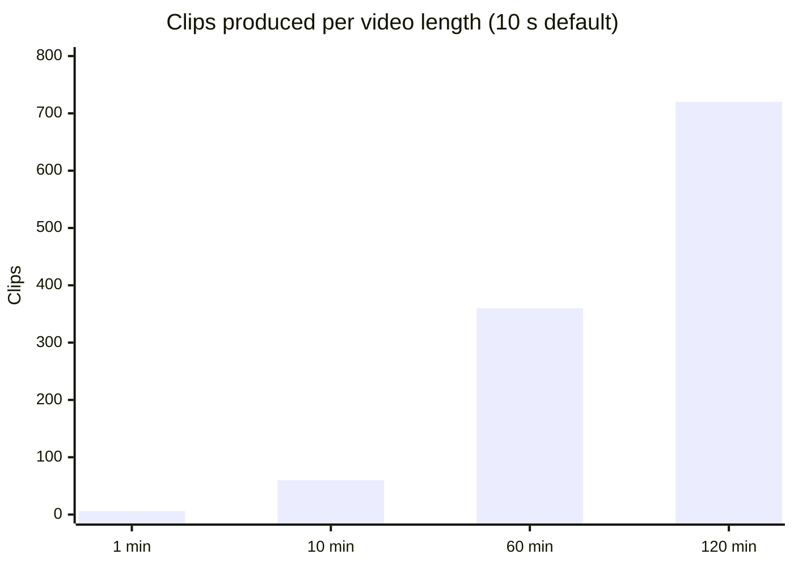
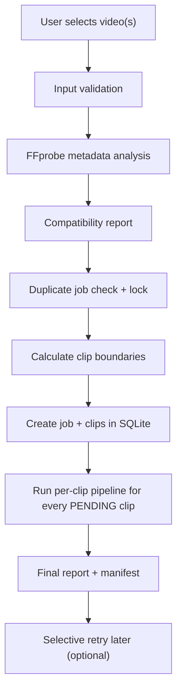
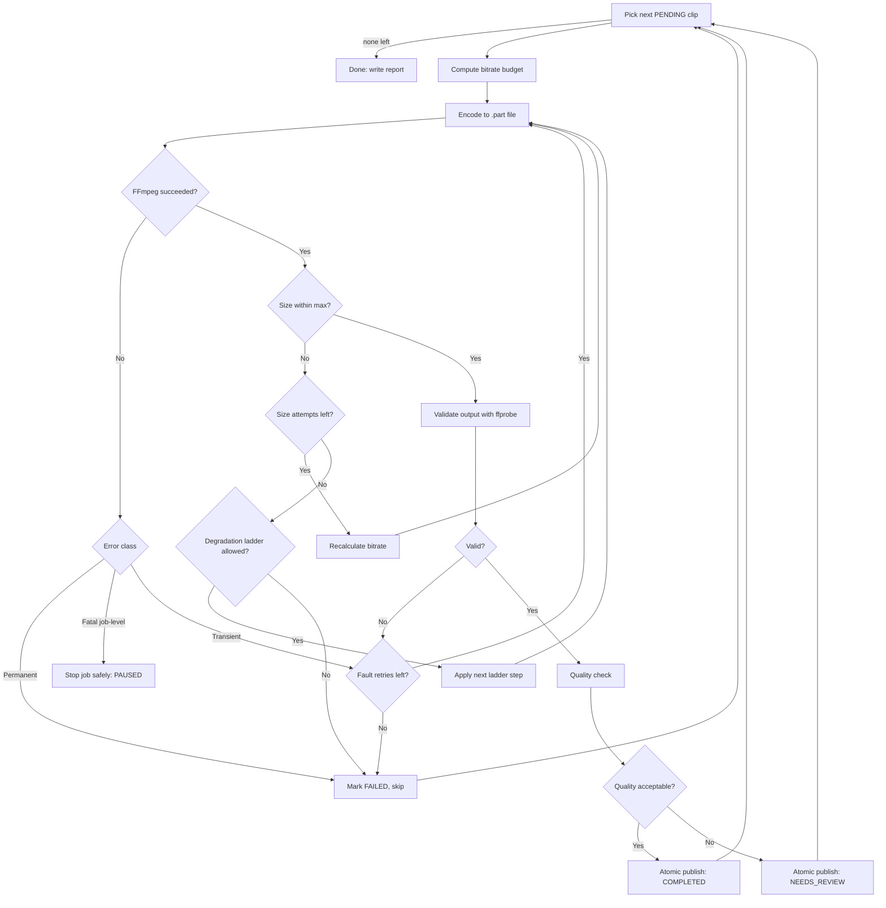
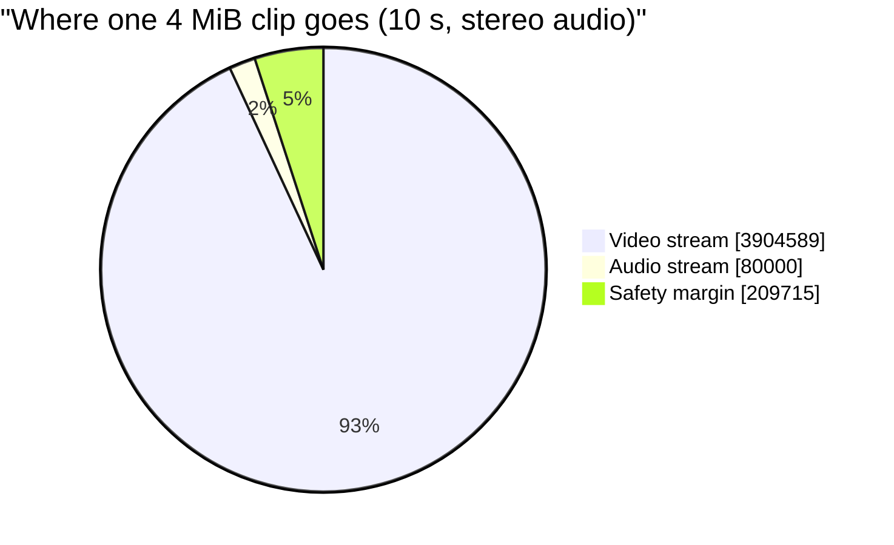
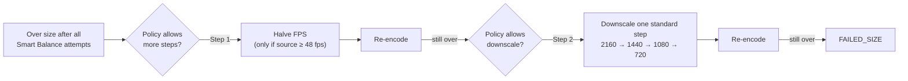
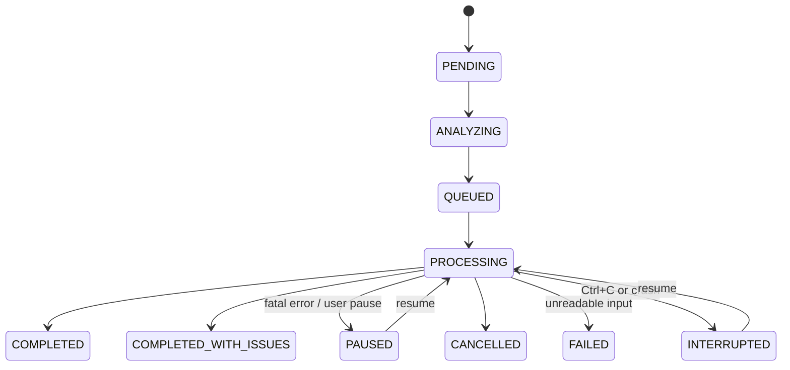
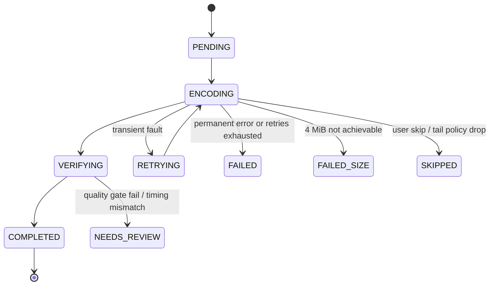

<div align="center">

# ClipForge

**Offline video splitter that cuts any local video into fixed-length WebM clips, each one capped at 4 MiB.**


</div>

> **Status: design phase.** The master blueprint (v2.0) is complete and reviewed. No implementation code exists yet. The CLI examples in this README show the planned v1.0 interface. See the [roadmap](#roadmap) for what gets built first.

---

## Contents

- [What it does](#what-it-does)
- [Why](#why)
- [Priority order](#priority-order)
- [A run in numbers](#a-run-in-numbers)
- [Architecture](#architecture)
- [Processing pipeline](#processing-pipeline)
- [The 4 MiB budget](#the-4-mib-budget)
- [Smart Balance: quality under a size cap](#smart-balance-quality-under-a-size-cap)
- [Fault tolerance](#fault-tolerance)
- [Pause, resume, recovery](#pause-resume-recovery)
- [State machines](#state-machines)
- [What lands on disk](#what-lands-on-disk)
- [Planned CLI](#planned-cli)
- [Terminal dashboard](#terminal-dashboard)
- [Configuration](#configuration)
- [Output files](#output-files)
- [Privacy and safety](#privacy-and-safety)
- [Project layout](#project-layout)
- [Testing approach](#testing-approach)
- [Roadmap](#roadmap)
- [Honest limits](#honest-limits)
- [License](#license)

---

## What it does

You point it at a video file, or a folder of them. ClipForge probes each file, shows a compatibility report, cuts the timeline into frame-accurate 10-second segments, and encodes every segment on its own. Each finished clip is verified and published atomically. At the end you get the clips, a `manifest.json` with hashes and attempt history, and a `report.json` summary.

Nothing leaves the machine. No account, no upload, no telemetry. FFmpeg and FFprobe do the media work; Python holds the logic together.

```text
holiday_video/  (10 minutes in → 60 clips out)
├── clip_0001.webm    00:00 - 00:10
├── clip_0002.webm    00:10 - 00:20
├── ...
├── clip_0060.webm    09:50 - 10:00
├── manifest.json
└── report.json
```

All clips stay at or under 4 MiB. Batch mode puts each video's clips in its own folder so nothing mixes.

## Why

I kept hitting the same wall with long local videos. Cloud converters wanted the file uploaded to someone else's server. Clipping tools produced output with no size guarantee. And anything that died halfway through a two-hour encode left me guessing which parts were actually done.

ClipForge is built against that exact set of problems. The 4 MiB ceiling is a hard requirement, not a guideline, because it matches real upload and storage limits. Reliability leads because a tool that loses or corrupts eight hours of encoding is worse than no tool at all.

## Priority order

When goals conflict, this order decides:

1. **Reliability.** A finished clip is never reported as in-progress. A crash never corrupts output.
2. **Size enforcement.** A successful clip never crosses 4 MiB.
3. **Quality.** The best the size limit allows, checked with real metrics.
4. **Performance.** Tuned to whatever hardware is available.

If quality has to drop to meet the size limit, quality drops. The size limit itself never bends.

## A run in numbers

| Source length | Clips at 10 s default |
|---|---|
| 1 min | 6 |
| 10 min | 60 |
| 60 min | 360 |
| 120 min | 720 |

Clip indexes use 4 digits, so a 9,999-clip job (about 27 hours of footage) still sorts correctly. Longer jobs widen the padding automatically.



## Architecture

```text
                      ┌────────────┐
                      │    CLI     │  (Typer)
                      └─────┬──────┘
                            │
              ┌─────────────▼─────────────┐
              │  FTJM                     │  scheduler, retries,
              │  fault-tolerant           │  recovery, state
              │  job manager              │  machines, locks
              └──┬──────────┬──────────┬──┘
                 │          │          │
        ┌────────▼───┐ ┌────▼─────┐ ┌──▼──────────┐
        │  Planner   │ │ Encoder  │ │  Storage    │
        │  probe +   │ │  FFmpeg  │ │  SQLite +   │
        │  boundaries│ │  wrapper │ │  manifest   │
        └────────────┘ └────┬─────┘ └─────────────┘
                            │
                   ┌────────▼────────┐
                   │    Optimizer    │  bitrate budget,
                   │  Smart Balance  │  size loop, quality
                   └─────────────────┘  gate, ladder
        Monitoring (CPU, RAM, disk, thermal) runs alongside
```

The FTJM treats every clip as an independent unit. One clip failing never blocks the other 359. All retry, recovery, and locking behavior lives in this one module, which keeps the rest of the code simple.

## Processing pipeline

Job level:



Per clip:



One hard cap applies across the whole loop: a clip gets at most 8 total FFmpeg runs, no matter how they are spent. Runaway loops are structurally impossible.

### Boundary math

Boundaries are computed in integer microseconds, never float seconds, so clip 360 lands exactly where it should instead of drifting a frame at a time. Intervals are half-open: `[start, end)`. A frame sitting exactly on a boundary belongs to the next clip, which removes both duplicate and missing frames. Re-encoding with input-seek keeps cuts frame-accurate; stream copy is not used because it only cuts on keyframes.

A video 605 seconds long ends with a 5-second tail. A video 600.2 seconds long would produce a 0.2-second tail, which is useless. The tail policy (`keep`, `merge_into_previous`, or `drop`) handles that case explicitly, with 1 second as the default minimum tail size.

## The 4 MiB budget

The hard limit is exactly 4,194,304 bytes. Targeting that number precisely is fragile: containers add overhead and encoders overshoot. So every clip aims 5% lower, at an internal target of 3,984,589 bytes (about 3.80 MiB), and the audio bitrate is subtracted first.

```text
max_bytes     = 4,194,304
target_bytes  = max_bytes × (1 − 0.05)            = 3,984,589
audio_bytes   = audio_bps × duration ÷ 8
video_bps     = (target_bytes − audio_bytes) × 8 ÷ duration
```

Worked example, one 10-second clip with stereo 64 kbps audio:

```text
audio_bytes = 64,000 × 10 ÷ 8            = 80,000
video_bps   = (3,984,589 − 80,000) × 8 ÷ 10 ≈ 3,123,671 bps ≈ 3.12 Mbps
```



Audio scales with channel count, since 5.1 audio quietly eats a large slice of the budget:

| Channels | Audio bitrate | 10 s cost |
|---|---|---|
| Mono | 40 kbps | ~50 KB |
| Stereo | 64 kbps | 80 KB |
| 5.1 | 160 kbps | 200 KB |
| 7.1 | 224 kbps | 280 KB |

### Is the budget even possible?

Before encoding anything, ClipForge estimates feasibility as bits-per-pixel-per-frame:

```text
bpp = video_bps ÷ (width × height × fps)
```

| Source | bpp at 3.12 Mbps | Meaning |
|---|---|---|
| 1080p, 30 fps | 0.050 | Usually comfortable |
| 4K, 60 fps | 0.0063 | Very tight; low quality or degradation expected |

The thresholds (roughly: 0.04+ comfortable, 0.02 to 0.04 tight, below 0.02 risky) are starting values and will be calibrated against real footage. `clipforge split --dry-run` shows this estimate per video, so a risky job is visible before any time is spent on it.

## Smart Balance: quality under a size cap

Smart Balance has a precise meaning: the best quality that fits the size limit, and no clip below the quality floor ever counts as "success".

- The encoder runs in constrained-quality mode (CRF plus a bitrate ceiling), so simple clips can come out smaller than the budget, which is a good outcome, not a problem.
- The starting CRF depends on resolution and bpp class, and never exceeds a configurable maximum.
- If an encode comes back over size, the bitrate is recalculated (always at least 3% lower) and the clip retries, up to 4 size attempts.
- Two consecutive oversize results promote the clip to two-pass rate control, which is slower but lands the size accurately.
- If output lands well under budget yet still fails the quality gate, the CRF drops and one more attempt runs. The balance works in both directions.

### Quality gates

| Tier | Metric | Cost on the target hardware | Default |
|---|---|---|---|
| 0 | Size and ffprobe validity | negligible | Always on |
| 1 | SSIM or PSNR | low to medium | On |
| 2 | VMAF (needs `libvmaf`) | high | Optional |

Sampling is configurable (`--quality-sample N`), so VMAF can run on every 5th clip instead of every clip. A clip that passes the size check but fails its quality gate is kept on disk and marked `NEEDS_REVIEW`. It does not count as completed.

### Degradation ladder

Some footage cannot fit 4 MiB at original quality. 4K 60 fps high-motion video is the obvious case. What happens then is a policy, not a surprise:



The default policy is `fail`, because preserving resolution and frame rate is the point of this tool. Choosing `--on-oversize fps`, `downscale`, or `both` opens the ladder. Every degradation is recorded in the manifest and report.

## Fault tolerance

Each clip is an independent unit. The job runs until every clip reaches a terminal state, or a fatal job-level error appears.

### Retry schedule

| Attempt | Action |
|---|---|
| 1 | Initial processing |
| 2 | First retry |
| 3 | Second retry |
| 4 | Third retry |
| After 4 fails | Mark `FAILED`, skip, move on |

Retries wait 2, then 5, then 10 seconds, and adjust with the error: suspected out-of-memory lowers threads and frame lag; a hardware encoder failure falls back to software VP9; a signal kill retries unchanged.

### Three separate counters

| Counter | Counts | Max | When exhausted |
|---|---|---|---|
| `size_attempts` | Successful encodes that came back over size | 4 | Degradation ladder, else `FAILED_SIZE` |
| `fault_retries` | Crashes, timeouts, invalid output, IO errors | 3 | `FAILED` |
| `total_encodes` | Every FFmpeg run of any kind | 8 | `FAILED_LIMIT` |

Keeping size tuning and fault retries separate matters: an oversized clip burning through its size budget should leave fault retries untouched for a real crash later.

### Error classification

| Class | Examples | Action |
|---|---|---|
| Tunable | Oversize output, quality below threshold | Handled by the optimizer, no fault retry spent |
| Transient | FFmpeg crash, timeout, temp write error, timing mismatch | Retry per the schedule above |
| Permanent (clip) | Undecodable corrupt data, invalid parameters | No retry, straight to `FAILED`, job continues |
| Fatal (job) | Disk full, unwritable output, missing FFmpeg | Job pauses safely, completed clips protected, clear message |

Classification comes from FFmpeg exit codes and stderr patterns, kept in one module so patterns are easy to extend. A `--tolerate-corruption` flag adds one lenient attempt (`-err_detect ignore_err`) for clips sitting in a corrupt region; whatever comes out is marked `NEEDS_REVIEW`.

### Watchdogs and corrupt regions

Encodes run under a timeout of `max(60 s, clip duration × timeout_factor)`. A hung FFmpeg gets SIGTERM, then SIGKILL five seconds later, and the clip counts a transient fault. Live progress via `-progress pipe:1` catches stalls too.

Corruption detection is realistic about what is possible upfront: a quick check validates headers and stream info, and a `--deep-scan` flag can decode the whole file when wanted. Containment handles the rest: if clip #137 falls in a corrupt region, only clip #137 fails. The other 359 finish normally.

## Pause, resume, recovery

Ctrl+C does a graceful shutdown: stop starting new clips, terminate the active FFmpeg process group, clean up the active `.part` file, leave completed clips untouched, commit the `INTERRUPTED` state to the database, and exit with code 130.

Resume (`clipforge resume <job>`, or rerunning the same command) then:

1. Loads the job from SQLite
2. Checks the input fingerprint and refuses if the source file changed
3. Quick-verifies every completed clip (file, size, ffprobe header)
4. Resets clips whose completed files are missing or invalid back to `PENDING`
5. Cleans up orphan `.part` files
6. Moves interrupted clips back to `PENDING`
7. Leaves `FAILED` clips alone; those need an explicit `retry --failed`
8. Processes the remaining pending clips

### Atomic publish

Encodes write to `<output_dir>/.clipforge_tmp/clip_0042.webm.part`. The temp folder lives inside the output folder, same filesystem, so the final step is a true atomic rename: verify, `fsync`, `os.replace()`. A `.part` file can never appear in a report as a completed clip.

### Locks and duplicates

Each job holds an `flock` on its output folder, so a second process on the same job fails fast with a clear error. Starting a job whose input fingerprint, output folder, and config all match an existing one triggers a prompt: resume, start fresh, or cancel.

### Disk space

Before a job starts, the estimated total (`clip_count × max_bytes × 1.05` plus temp margin) is checked against free space, and a short job is refused rather than dying at clip 300. At runtime, every clip starts with a free-space check; dropping below the threshold pauses the whole job with completed clips intact.

## State machines

Job:



Clip:



After a crash, any clip found in `ENCODING`, `VERIFYING`, or `RETRYING` resets to `PENDING`, with its `.part` file cleaned up. A job that finishes with some failed or review clips reports `COMPLETED_WITH_ISSUES` and exits 1, so scripts can react.

## What lands on disk

| What | Where |
|---|---|
| Config | `~/.config/clipforge/config.yaml` |
| Database | `~/.local/share/clipforge/clipforge.db` |
| Logs | `~/.local/state/clipforge/logs/` |
| Output | `--output DIR`, or `./<video_name>/` by default |
| Temp `.part` files | `<output_dir>/.clipforge_tmp/` |

SQLite runs in WAL mode with foreign keys on and `synchronous=NORMAL`, so a crash mid-job leaves a consistent database. Four tables hold the state:

| Table | Holds |
|---|---|
| `jobs` | Input path, fingerprint (size plus SHA-256 of first/middle/last 1 MiB), config snapshot, probe summary, status |
| `clips` | One row per clip: boundaries, status, size, SHA-256, all three counters, error class and code, quality score |
| `attempts` | One row per encode: parameters used, result, size, exit code, last 2 KB of stderr |
| `events` | Timestamped log of state changes, level, and message |

State changes commit in a single transaction before the file rename happens. If the database itself is ever damaged, `clipforge verify` rebuilds state from `manifest.json` and the files on disk. Full FFmpeg stderr goes to per-job logs; the database keeps only a bounded tail so it cannot balloon.

## Planned CLI

Built with Typer: subcommands, auto-help, shell completion.

| Command | Function |
|---|---|
| `clipforge info` | System and version information |
| `clipforge doctor` | FFmpeg, FFprobe, codec, libvmaf, VAAPI diagnostics |
| `clipforge probe <file>` | Video metadata and compatibility report |
| `clipforge split <file>` | Split and encode; `--dry-run` plans only |
| `clipforge batch <dir>` | Multiple videos |
| `clipforge queue` | Queue list, pause, priority |
| `clipforge status [job]` | Job and clip status |
| `clipforge resume <job>` | Resume an interrupted job |
| `clipforge retry <job>` | Selective retry (`--failed`, `--needs-review`) |
| `clipforge reprocess <job>` | Re-encode specific clips (`--clip 17`, `--clips 17-25`) |
| `clipforge verify <job>` | Output integrity check (`--deep` for full decode) |
| `clipforge cancel <job>` | Cancel a job |
| `clipforge report <job>` | Print or export the report |
| `clipforge config` | Show, edit, validate config |
| `clipforge benchmark <file>` | Encode a few sample clips, report time, size, RAM, temperature |
| `clipforge clean` | Remove orphan temp files |

Completed clips are protected by default: re-encoding one requires an explicit `--clip N`, and a fresh output replaces the old one only after the new version passes verification. Reprocessing an input whose fingerprint changed is refused, with `--relocate /new/path.mp4` available after a move.

```bash
clipforge probe video.mp4
clipforge split video.mp4 --duration 10 --max-size 4MiB --dry-run
clipforge split video.mp4 --duration 10 --max-size 4MiB --output ./converted
clipforge batch ./videos/ --recursive --duration 10 --max-size 4MiB
clipforge retry 12 --failed
clipforge reprocess 12 --clip 17 --profile best
```

Exit codes, for scripting:

| Code | Meaning |
|---|---|
| 0 | All clips completed |
| 1 | Job finished, some clips failed or need review |
| 2 | Usage or invalid arguments |
| 3 | Dependency missing (FFmpeg, and so on) |
| 4 | Fatal error (disk full, database failure) |
| 130 | Interrupted by user |

FFmpeg always runs with an argument list, never a shell string. Filenames with spaces, quotes, or a leading dash are handled safely with `--` and a `file:` prefix.

## Terminal dashboard

```text
╔══════════════════════════════════════════════════╗
║                  CLIPFORGE v2                    ║
║            OFFLINE VIDEO PROCESSOR               ║
╠══════════════════════════════════════════════════╣
║ Input:  holiday_video.mp4                        ║
║ Duration: 00:10:00   1920x1080   30 fps          ║
║ Output: WebM / VP9 / Opus   Profile: balanced    ║
╠══════════════════════════════════════════════════╣
║ Progress: 47 / 60     [███████████████░░░░] 78%  ║
║ ETA: 00:06:40         Elapsed: 00:23:10          ║
║                                                  ║
║ Current: clip_0048.webm                          ║
║ Attempt: size 2/4 · fault 0/3                    ║
║ Size: 3.42 MiB / 4.00 MiB (target 3.80)          ║
╠══════════════════════════════════════════════════╣
║ CPU 62%   RAM 1.1 GB   Temp 71C   Disk 38 GB free║
╠══════════════════════════════════════════════════╣
║ Completed 47 · Active 1 · Pending 12             ║
║ Failed 0 · Needs review 0                        ║
╚══════════════════════════════════════════════════╝
```

The counters obey one rule: `completed + active + pending + failed + review = total`. When stdout is not a TTY (pipes, cron), the dashboard switches to plain log lines with `--no-dashboard`, and `--json-progress` gives machine-readable progress.

## Configuration

One YAML file at `~/.config/clipforge/config.yaml`, validated with pydantic. CLI flags override config, config overrides built-in defaults. A wrong value produces a clear error, not a mystery.

```yaml
version: 2

processing:
  clip_duration_seconds: 10
  tail_policy: merge_into_previous
  min_tail_seconds: 1.0
  seek_mode: fast
  fps_mode: preserve

output:
  container: webm
  video_codec: libvpx-vp9
  audio_codec: libopus
  max_size: 4MiB
  safety_margin_percent: 5
  profile: balanced
  on_oversize: fail
  audio_channels: keep
  hdr: keep

optimizer:
  size_attempts: 4
  max_total_encodes: 8
  crf_start: auto
  crf_max: 45
  two_pass_fallback: true

quality:
  metric: ssim
  sample_every: 1
  ssim_min: 0.95
  vmaf_min: 80

fault_tolerance:
  fault_retries: 3
  retry_delays_seconds: [2, 5, 10]
  timeout_factor: 20
  tolerate_corruption: false

performance:
  concurrent_jobs: 1
  ffmpeg_threads: 3
  hw_accel: off
  max_ram_mb: 1500
  thermal_pause_celsius: 90

paths:
  database: ~/.local/share/clipforge/clipforge.db
  logs: ~/.local/state/clipforge/logs
```

Hardware acceleration is off by default. Hardware VP9 encoders usually trade quality for speed, and on the target hardware (an i3-1215U with Intel UHD graphics) support depends on the driver and FFmpeg build. `clipforge doctor` reports what is available; `--hw-accel auto` opts in with a software fallback. A `benchmark` command encodes a few sample clips under different profiles and thread counts so the defaults get tuned on real numbers instead of guesses.

## Output files

`manifest.json`, updated atomically after every clip:

```json
{
  "input": "holiday_video.mp4",
  "input_fingerprint": "sha256:...",
  "clip_duration_seconds": 10,
  "clips": [
    {
      "index": 1,
      "file": "clip_0001.webm",
      "start": 0.0,
      "end": 10.0,
      "size_bytes": 3741920,
      "sha256": "...",
      "status": "COMPLETED",
      "size_attempts": 1,
      "fault_retries": 0,
      "degraded": null,
      "quality": { "metric": "ssim", "score": 0.967 }
    }
  ]
}
```

`report.json`, written when the job ends:

```json
{
  "input": "holiday_video.mp4",
  "duration_seconds": 600,
  "clip_duration_seconds": 10,
  "expected_clips": 60,
  "completed_clips": 58,
  "needs_review_clips": 1,
  "failed_clips": 1,
  "failed_details": [
    { "index": 17, "class": "permanent", "code": "DECODE_ERROR", "attempts": 1 }
  ],
  "total_encodes": 71,
  "largest_clip_bytes": 4012331,
  "total_time_seconds": 1388,
  "degraded_clips": 0
}
```

The terminal summary at the end names the exact command to rerun for whatever failed.

## Privacy and safety

- No cloud upload, no telemetry, no automatic external requests. Network use is limited to installing the tool.
- The input file is treated as read-only and is never moved, modified, or deleted.
- Input and output paths that overlap are refused outright.
- Subprocesses run from argument lists only; no shell interpolation anywhere.
- Output paths are confined to the chosen output folder; traversal is blocked.
- Database and logs carry user-only permissions (0600 files, 0700 directories).

## Project layout

```text
ClipForge/
├── src/clipforge/
│   ├── cli/            # Typer commands, option parsing, exit codes
│   ├── core/           # models, config, errors, constants
│   ├── probe/          # ffprobe wrapper, metadata, compatibility report
│   ├── planner/        # boundary calculation, tail policy, feasibility
│   ├── encoding/       # ffmpeg command builder, profiles, runner, progress parser
│   ├── optimizer/      # budget, size loop, ladder, quality metrics
│   ├── manager/        # FTJM: scheduler, retry, error classifier, recovery, locks
│   ├── storage/        # SQLite, migrations, manifest writer
│   ├── monitoring/     # CPU/RAM/disk/thermal, Rich dashboard
│   ├── reporting/      # report.json, terminal summaries
│   └── utils/          # paths, hashing, fsync/atomic helpers, time utils
├── tests/
│   ├── unit/
│   ├── integration/
│   └── fixtures/       # generated test videos (built by script, not committed)
├── scripts/            # make_fixtures.sh, benchmark helpers
├── docs/
├── pyproject.toml
├── README.md
└── LICENSE
```

## Testing approach

Test videos are generated with FFmpeg's synthetic sources, so the repo never carries large media files. Fixtures cover plain 1080p30, a noise-stressed worst case for size, truncated and mid-file-corrupt files, VFR, rotated phone video, HDR, and multichannel audio.

The unit tests concentrate on pure logic where bugs are cheapest to catch: boundary math (integer, half-open, tail policy), the bitrate budget formula, recalculation behavior (always at least 3% lower), the error classifier, state machine transitions, and the counter caps.

Reliability tests simulate the ugly cases directly: interrupting mid-encode and resuming, `kill -9` on FFmpeg, a full disk on a small tmpfs, a changed input file between runs, duplicate jobs, a corrupted database, and orphan `.part` cleanup.

The v1.0 acceptance bar:

1. A 10-minute 1080p30 video produces 60 clips, all at or under 4 MiB.
2. Resume after a mid-job interruption re-encodes nothing that was finished and misses nothing.
3. In a video with one corrupt region, only the affected clips fail.
4. Peak RAM on 1080p stays within the target.
5. Report, manifest, and database agree with each other.

## Roadmap

Each milestone ends with a tool that actually runs.

| # | Milestone | Delivers | Done when |
|---|---|---|---|
| M0 | Setup | Repo, pyproject, Typer skeleton, `doctor` | `doctor` detects FFmpeg, FFprobe, libvpx, libopus |
| M1 | Probe + planner | `probe`, `split --dry-run` | Boundary unit tests pass (tail, VFR flags, start time) |
| M2 | MVP encode | One video to clips, basic size check and retry, no database | 10-min test video yields 60 clips, all ≤ 4 MiB |
| M3 | Optimizer | Budget, CQ mode, size loop, two-pass fallback, ladder, SSIM gate | Predictable behavior on noisy and 4K fixtures; caps enforced |
| M4 | Persistence | SQLite, state machines, atomic publish, manifest, resume | Ctrl+C then resume, zero duplicate encodes |
| M5 | Fault tolerance | Error classifier, fault retries, watchdog, `retry`, `reprocess`, `verify` | Kill-test and corrupt-test pass |
| M6 | Batch + queue + dashboard | `batch`, `queue`, Rich dashboard, locks | Multi-video job stable |
| M7 | Performance | Resource monitor, thermal guard, `benchmark`, profile tuning | Defaults finalized from real numbers |
| M8 | Hardening | Full test matrix, docs, error message polish | Acceptance criteria above pass |
| M9 | Packaging | PKGBUILD, pipx, man page, completion | Clean install on Arch |

First coding session targets M0 + M1, since both are pure logic and everything else stands on them.

## Honest limits

- Not every 10-second clip fits 4 MiB at original quality. Smart Balance keeps the loss controlled and flags anything below the quality floor rather than pretending it succeeded.
- WebM/VP9/Opus does not carry every source format. 4:2:2 and 4:4:4 chroma convert to 4:2:0, 10-bit needs VP9 Profile 2 (narrow player support), and HDR is kept with a warning in v1.0.
- Independent clips are separate files. Back-to-back gapless playback is not guaranteed, since Opus pre-skip can leave a small discontinuity at boundaries.
- Encoding speed depends on resolution, motion, profile, thread count, and CPU temperature. An hour of video is 360 clips, so realistic ETAs matter and the dashboard shows them.
- Numbers marked as tunable (CRF ranges, thresholds, timeout factor, thread counts) are starting values. They get finalized from benchmarks on the target hardware, not from theory.

## License

GPL-3.0. See [LICENSE](LICENSE).

One caveat worth knowing: FFmpeg's own licensing is build-dependent, and builds with GPL components carry different terms than minimal ones. The diagnostics in `clipforge doctor` report which build you are running with.
